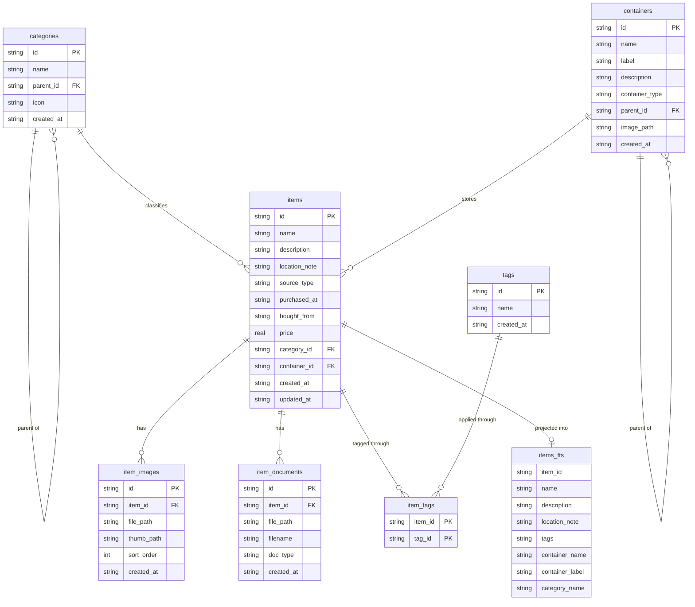
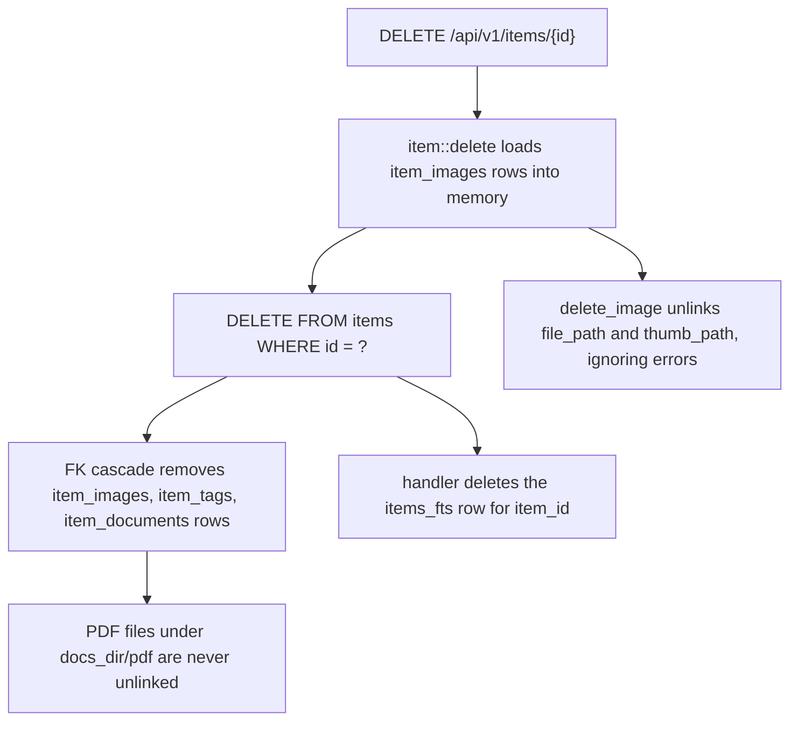

# Data model, migrations, and delete semantics

The whole application persists into one SQLite file. There is no separate schema tool, no ORM, and no migration command: the schema ships inside the binary, is applied the moment the process starts, and every write path in `server/src/repositories/` speaks raw SQL against it. This page documents the tables, the referential rules that actually run, and the deletion side effects — including the ones that leak files on disk.

Related reading: [HTTP API and errors](http-api-and-errors.md) for the request layer that drives these writes, [hierarchy and location](../concepts/hierarchy-and-location.md) for how the two trees are assembled and rendered, [search and index sync](../concepts/search-and-index-sync.md) for the query side of `items_fts`, and [configuration](../operations/configuration.md) for where the database file lives.

## Where the schema lives

| Path | Role |
| --- | --- |
| `server/migrations/0001_init.sql` | Base schema: `categories`, `containers`, `items`, `item_images`, `tags`, `item_tags`, indexes, and the `items_fts` virtual table |
| `server/migrations/0002_documents.sql` | Adds `item_documents` plus `idx_item_documents_item` to an existing database |
| `server/migrations/0003_item_location_note.sql` | Adds `items.location_note`, then drops and recreates `items_fts` to index it |
| `server/src/db.rs` | Opens/creates the pool and runs the embedded migrations |
| `server/src/repositories/*.rs` | Every SELECT/INSERT/UPDATE/DELETE; no query lives in handlers |

There are no triggers, views, or stored procedures anywhere in the tree. All invariants are either schema constraints or hand-written SQL in repositories.

## Migration workflow: embedded, applied on every startup

`db::init` is the only entry point (`server/src/db.rs`), and it does four things in order:

1. Creates the parent directory of `db_path` if missing, then connects with `create_if_missing(true)` so a fresh install bootstraps itself.
2. Opens a pool capped at 5 connections.
3. Runs `sqlx::migrate!("./migrations").run(&pool)` and panics via `.expect("failed to run migrations")` if that fails.
4. Returns the pool; `main.rs` then immediately calls `search_index::sync_all(&pool)` so the FTS projection is rebuilt before the HTTP listener binds.

Consequences worth internalising:

- **Schema change = new numbered file + rebuild.** The `migrate!` macro reads `server/migrations/` at *compile* time and embeds the SQL into the binary. Dropping a `.sql` file next to the others and recompiling is the entire workflow; nothing must be run at deploy time. This is why `just build` treats `server/migrations` as a build input.
- **Never edit an applied migration.** sqlx records each applied version and its checksum in its own bookkeeping table; an already-applied file whose content changed fails validation on the next startup, and because `init` uses `expect`, the process aborts instead of serving with a half-trusted schema. To change something, add the next number.
- **Upgrades happen on first start of the new binary.** Deploying a new binary against an existing database file mutates it in place, so back up the SQLite file before upgrading (see [configuration](../operations/configuration.md) for the XDG-derived data directory).
- **There is no reset path in code.** `just reset-db` deletes `data/` wholesale; dropping a table by hand leaves the sqlx bookkeeping table disagreeing with reality.
- Order within a migration is load-bearing: `0003` drops `items_fts` *after* altering `items`, and it relies on `sync_all` on the same startup to refill the index (see below).

## Schema at a glance



Tables, keys, and the declared referential actions (from `0001` and `0002`):

| Table | Key | References and declared action |
| --- | --- | --- |
| `categories` | `id` TEXT | `parent_id → categories(id) ON DELETE SET NULL` |
| `containers` | `id` TEXT | `parent_id → containers(id) ON DELETE SET NULL` |
| `items` | `id` TEXT | `category_id → categories(id) ON DELETE SET NULL`, `container_id → containers(id) ON DELETE SET NULL` |
| `item_images` | `id` TEXT | `item_id → items(id) ON DELETE CASCADE` (NOT NULL) |
| `item_documents` | `id` TEXT | `item_id → items(id) ON DELETE CASCADE` (NOT NULL), `doc_type` defaults to `'pdf'` |
| `tags` | `id` TEXT | `name` is `UNIQUE` |
| `item_tags` | `(item_id, tag_id)` composite PK | both columns cascade, so links vanish with either parent |
| `items_fts` | none (FTS5 virtual table) | no foreign key at all; `item_id` is `UNINDEXED` and acts as a soft pointer |

Supporting indexes: `idx_items_category`, `idx_items_container`, `idx_items_source_type`, `idx_categories_parent`, `idx_containers_parent`, `idx_item_images_item`, `idx_item_tags_item`, `idx_item_tags_tag`, `idx_item_documents_item`. Note there is no index on `items.name`/`description` because the FTS table covers search, and no `UNIQUE` on `categories.name`.

### Column conventions

- **IDs are UUID v4 strings generated in Rust** (`uuid::Uuid::new_v4().to_string()`), not by SQLite. Every table stores them as `TEXT PRIMARY KEY`. There are no integer surrogate keys and no autoincrement anywhere.
- **Timestamps are TEXT in SQLite's `datetime('now')` format** (UTC, `YYYY-MM-DD HH:MM:SS`), always defaulted by the column, always read as `String`. Because the format is fixed-width and UTC, lexicographic ordering equals chronological ordering — the item list relies on that when it does `ORDER BY i.created_at DESC`.
- **Only `items` has `updated_at`.** `categories`, `containers`, `tags`, `item_images`, `item_documents` are create-only from the schema's point of view; they have no modification timestamp to inspect. `items.updated_at` is maintained explicitly by `item::update` (`updated_at = datetime('now')`), not by a trigger.
- **Nullable text columns are the norm** (`description`, `label`, `icon`, `image_path`, `purchased_at`, `bought_from`, `price`, both foreign keys). "Unset" is `NULL` for items and containers, and "unassigned" items are rendered by the frontend as 未归位.
- **Defaults carry product semantics**: `items.source_type` defaults to `'handmade'`, `containers.container_type` defaults to `'other'`, `item_documents.doc_type` defaults to `'pdf'`, `item_images.sort_order` defaults to `0`.
- **No compile-time SQL checking.** Queries are built with runtime APIs (`sqlx::query_as::<_, T>(&sql)`, `query_scalar`), some assembled with `format!` from filter fragments, and rows are mapped by `#[derive(sqlx::FromRow)]` structs. There is no `query!` macro, no `DATABASE_URL`, no `.sqlx` offline cache — `cargo build` never touches a database, and a column rename compiles fine and fails at runtime.

## Referential behavior: declared vs. hand-written

The schema declares `ON DELETE SET NULL` for the two trees and for item→category/container, and `ON DELETE CASCADE` for the item-owned tables. But the repository code does not simply lean on those clauses:

| Delete operation | Hand-written SQL (repository) | Relies on declared FK action for | Files touched |
| --- | --- | --- | --- |
| `category::delete` | `UPDATE items SET category_id = NULL`, `UPDATE categories SET parent_id = NULL`, then `DELETE FROM categories` | nothing | none |
| `container::delete` | `UPDATE items SET container_id = NULL`, `UPDATE containers SET parent_id = NULL`, then `DELETE FROM containers` | nothing | **nothing** — `containers.image_path` is a plain column, so a container photo stays on disk |
| `item::delete` | reads `item_images` rows first, then `DELETE FROM items` | **all child rows**: `item_images`, `item_tags`, `item_documents` disappear only because of the declared `CASCADE` | unlinks each image and its thumb; PDFs survive |
| `tag::delete` | `DELETE FROM tags` | `item_tags` links via cascade from the tag side | none |
| `item::remove_image` / `remove_document` | selects the row by `(image_id|doc_id, item_id)`, deletes it, then unlinks the file | nothing | removes that image+thumb, or that PDF |

Two notes on why this asymmetry matters:

- **The tree deletes are belt-and-braces.** Because `category::delete` and `container::delete` explicitly null the referencing columns and the children's `parent_id` before removing the row, the children/items behaviour is deterministic regardless of pragma state. Nothing in `server/src` issues `PRAGMA foreign_keys`; the item delete path, by contrast, performs **no** explicit child-row deletion, so cleanup of `item_images`, `item_tags`, and `item_documents` depends entirely on the declared cascades actually being enforced by the connection (sqlx enables `foreign_keys` by default on its SQLite connections — do not assume a raw connection would).
- **No delete touches the FTS index except item delete.** `category::delete`, `container::delete`, and `tag::delete` remove rows that `items_fts` had folded into its text (`category_name`, `container_name`, `container_label`, `tags`). The index keeps the old strings until the next process start runs `sync_all`. See [search and index sync](../concepts/search-and-index-sync.md).

### Item delete, end to end



What each participant is responsible for:

- `repositories::item::delete` captures the image rows *before* deleting, because after the cascading `DELETE` there is no record of which files to remove.
- `handlers::item::delete` is what removes the `items_fts` row (`DELETE FROM items_fts WHERE item_id = ?`). The repository never touches the index, so any other caller of `item::delete` would leave a search row pointing at a vanished item.
- The filesystem cleanup uses `services::image::delete_image`, which joins `image_dir` with the stored relative paths and swallows errors. Missing files are silently fine.
- **Documented gaps.** Deleting an item removes image and thumbnail files but leaves the PDFs (and their `item_documents` rows are already gone, so nothing references them). Re-uploading a container image overwrites `containers.image_path` without unlinking the previous file. For the on-disk layout and URL contract behind these paths, see [uploads and storage](../concepts/file-storage-and-url-contract.md).

A related consistency rule for the media tables: `item_images.sort_order` is computed as `MAX(sort_order) + 1` per item at insert time and images are read back ordered by it; there is no uniqueness constraint, so concurrent uploads can tie.

## `items_fts` is a derived projection, not a source of truth

`items_fts` is a plain (content-ful) FTS5 table declared in `0001`:

```sql
CREATE VIRTUAL TABLE items_fts USING fts5(
    item_id UNINDEXED,
    name,
    description,
    tags,
    container_name,
    container_label,
    category_name,
    tokenize = 'trigram'
);
```

Properties a schema editor must respect:

- **It is a cache.** Every string in it is copied from `items`, `tags`, `containers`, or `categories`. Nothing reads it as the authority for display; `search.rs` always joins back to `items` for real columns and only uses the FTS table for matching, `rank`, and `snippet()`.
- **No triggers, no external content.** It is not `content='items'` and there are no `AFTER INSERT/UPDATE/DELETE` triggers, so it is refreshed exclusively by `services/search_index.rs`: `sync_item` for one item (called from item create/update handlers and after item delete the row is deleted directly), and `sync_all` on every startup. `docs/design.md` still describes a trigger-based design; the code does not have one.
- **Column order is an API.** `snippet(items_fts, 1|2|3, …)` addresses `name`, `description`, and `location_note` by position. Reordering or inserting a column silently changes which text is highlighted, so a schema edit here must be paired with `repositories/search.rs`.

### Why `0003` drops and recreates the table

`0003_item_location_note.sql` adds `items.location_note`, then performs `DROP TABLE items_fts` followed by a full `CREATE VIRTUAL TABLE` with `location_note` inserted as the fourth column. An FTS5 table's column set is fixed at creation time — there is no `ALTER TABLE ... ADD COLUMN` for virtual tables — so the only way to index a new field is to rebuild the index. Dropping it destroys every indexed row, which is acceptable precisely because the table is a derived projection:

1. The migration empties the index while leaving `items` intact.
2. `db::init` returns, and `main.rs` calls `sync_all`, which truncates and repopulates `items_fts` from the source tables on the same startup.
3. If that `sync_all` fails, `main.rs` only logs `FTS sync on startup failed` and keeps serving — a temporarily empty search index is treated as degraded, not fatal.

Consequence: after applying `0003`, any process that migrated without running the Rust startup path (a manual `sqlite3` session, for example) would leave search returning nothing until the next real start.

## Write-path invariants that reach the schema

These are enforced in repository SQL rather than by constraints, and they bite anyone adding an endpoint:

- **`PUT` on an item replaces nullable columns.** `item::update` binds `input.description`, `location_note`, `purchased_at`, `bought_from`, `price`, `category_id`, and `container_id` with `as_deref()`, so an omitted field clears the column; only `name` and `source_type` fall back to the stored value. Detaching an item from its category/container is therefore a normal `PUT`.
- **Tree nodes cannot be promoted to root via `PUT`.** `category::update` and `container::update` bind `input.parent_id.or(existing.parent_id)`, so an omitted or `null` `parent_id` keeps the old parent — a node can be re-parented but not detached; only deleting its parent orphans it.
- **Tag creation is idempotent.** `tag::create` first selects by `name` and returns the existing row, so `item_tags` never accumulates duplicate labels; `tags.name UNIQUE` is the backstop for concurrent creates.
- **`item::set_tags` is delete-then-insert** per item, with no transaction, so a failure mid-loop can leave an item with fewer tags than requested.
- **Multi-statement writes are not wrapped in transactions.** Category/container delete, item delete, document removal, and FTS resync are each a sequence of independent statements; a crash between them leaves a partially applied state (e.g. files removed but rows intact, or children nulled but the parent row still present).

Ordering caveat for lists: `item::list` pages with `ORDER BY i.created_at DESC LIMIT ? OFFSET ?` over second-granularity timestamps and no tiebreaker, so items created in the same second can shift between pages.

## Changing the schema safely

1. Add `server/migrations/000N_<short_description>.sql` with the next unused number. Never edit or renumber an applied file.
2. Write the file as a one-time change: each version runs exactly once per database and later starts skip it by version, so no `IF NOT EXISTS` guard is needed (and a new file must be applicable to databases that already contain rows).
3. If you touch `items_fts` columns, update `services/search_index.rs` (insert column list), `repositories/search.rs` (`snippet()` indices, `MATCH` columns, and the `< 3`-character LIKE fallback which enumerates `name`, `description`, `location_note`, container `name`/`label`, and category `name`), and link [search and index sync](../concepts/search-and-index-sync.md).
4. If you add a nullable column, decide whether `item::update`/`container::update` should overwrite it with `NULL` when absent — that is the current behaviour for most fields.
5. If you add a table owned by an item, declare `item_id ... ON DELETE CASCADE`, or the item delete path will leave orphan rows (it performs no child cleanup itself); if the rows own files, also extend `item::delete`, which only knows about `item_images`.
6. Mirror any field the API returns into `web/src/types/index.ts` and the relevant repository SELECTs — nothing is generated.
7. Rebuild (`just build`) so the embedded migrations and `web/dist` match the binary, then verify by starting the server once.

## Verification and failure modes

There are no automated tests for persistence — `server/tests/` is empty and `AGENTS.md` records the same; `just test` currently proves nothing about the schema. Practical checks:

```bash
# inspect the applied schema and migration bookkeeping after a start
sqlite3 "$XDG_DATA_HOME/wheremystuff/wheremystuff.db" ".tables"
sqlite3 "$XDG_DATA_HOME/wheremystuff/wheremystuff.db" "SELECT version, description FROM _sqlx_migrations;"

# confirm the projection recovered after a migration
sqlite3 "$XDG_DATA_HOME/wheremystuff/wheremystuff.db" "SELECT COUNT(*) FROM items_fts;"
```

Failure modes to expect when this area is edited badly:

| Symptom | Cause |
| --- | --- |
| Server exits at startup with `failed to run migrations` | edited an applied migration (checksum mismatch) or a syntax error in a new file; `init` panics via `expect` |
| Search returns results but highlights the wrong field | `items_fts` column order changed without updating `snippet()` indices in `search.rs` |
| Search misses a recently renamed category/tag/container | no resync on those writes; only restart (`sync_all`) repairs it |
| Item detail shows images whose files 404 | files removed by hand, or the image row's relative path no longer matches `image_dir` |
| Disk usage grows after deletions | leftover PDFs from deleted items and orphaned container images |
| Orphan `item_images`/`item_tags` rows after deleting an item | the connection was not enforcing foreign keys, so the declared cascades never fired |
