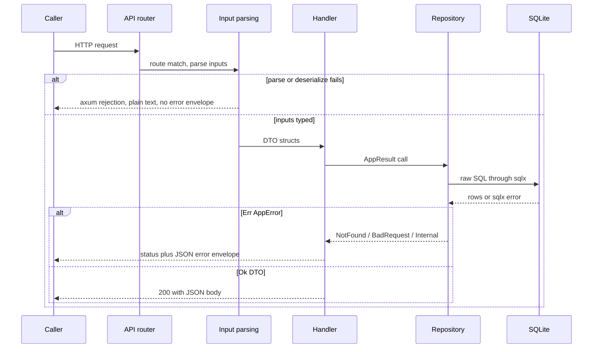

# HTTP API surface, DTO semantics, and error contract

Everything an external caller can reach is declared in one file: `server/src/routes.rs` builds a `Router` of 28 routes, and `server/src/main.rs` mounts that router under `/api/v1`. There is no OpenAPI document, no generated client, and no controller layer — the handler signature *is* the contract, and the Rust DTOs in `server/src/models/` are mirrored by hand into `web/src/types/index.ts`. This page is the reference table other pages link to instead of re-listing routes.

Related reading: [overview](overview.md) for how the process boots, [DTO and type mirroring](../concepts/api-dto-and-type-mirroring.md) for the Rust→TypeScript mirroring rules, [file storage and URL contract](../concepts/file-storage-and-url-contract.md) for what `image_path` / `thumb_path` / `file_path` mean on disk and as URLs, [frontend/backend contract](../integrations/frontend-backend-contract.md) for how the SPA calls these routes, and [data model and migrations](data-model-and-migrations.md) for the tables and delete side effects behind each write.

## Process-level wiring around the API

`main.rs` composes four things into one `Router`:

| Layer / mount | Detail |
| --- | --- |
| `.nest("/api/v1", routes::api_routes(pool))` | All JSON endpoints live below this prefix; the strings in the route table below are relative to it |
| `.nest_service("/images", ServeDir::new(image_dir))`, `.nest_service("/docs", ServeDir::new(docs_dir))` | Uploaded files are served as static files, not through handlers |
| `.fallback(static_files::handler)` | Anything not matched by the three mounts is answered from `web/dist` baked into the binary; unknown SPA paths return `index.html` with 200 |
| `.layer(DefaultBodyLimit::max(100 * 1024 * 1024))`, `.layer(CorsLayer::permissive())`, `.layer(TraceLayer::new_for_http())` | One global 100 MB body ceiling (for PDF uploads), permissive CORS, and per-request tracing |

Two consequences worth internalising before reading the handler code: the 100 MB ceiling is a compile-time constant that applies to *every* request including JSON bodies, and it is not the per-file upload limit — that one comes from `config.upload.*` and is enforced inside the handlers (see [upload constraints](#upload-constraints)).

## Route table

Every route registered in `server/src/routes.rs`, with the handler it resolves to and the DTO types crossed at the boundary. `Path` parameters are opaque `String` ids (UUIDs) — nothing validates their format, so a malformed id misses the row. All successful responses are `200 OK` with a JSON body; there are no `201`/`204` responses anywhere.

Two routing facts that shape the table:

- **Reads and updates 404 on an unknown id, deletes do not.** `GET`/`PUT` handlers call `container::get` / `item::get` / `category::get` (via `update`) / `tag::get` first, which raises `AppError::NotFound`. `DELETE /categories/{id}`, `DELETE /containers/{id}`, `DELETE /items/{id}`, and `DELETE /tags/{id}` issue an unconditional `DELETE` and therefore return `{"ok":true}` for an id that never existed — they are idempotent. The exceptions are `DELETE /items/{id}/images/{image_id}` and `DELETE /items/{id}/documents/{doc_id}`, which select the child row by `(child_id, item_id)` and 404 when it is missing.
- **The literal segments win over `{id}`.** `/containers/tree` and `/tags/autocomplete` are registered alongside `/containers/{id}` and `/tags/{id}`; axum's matcher prefers the static segment, so registration order is irrelevant here.

| Method | Path (under `/api/v1`) | Handler | Request | Response |
| --- | --- | --- | --- | --- |
| GET | `/categories` | `handlers::category::list` | – | `Vec<Category>` (flat, `ORDER BY name`) |
| GET | `/categories/tree` | `handlers::category::list_tree` | – | `Vec<CategoryNode>` |
| POST | `/categories` | `handlers::category::create` | `CreateCategory` | `Category` |
| PUT | `/categories/{id}` | `handlers::category::update` | `UpdateCategory` | `Category` |
| DELETE | `/categories/{id}` | `handlers::category::delete` | – | `{ "ok": true }` |
| GET | `/containers` | `handlers::container::list` | query `parent_id?` (`ListQuery`) | `Vec<Container>` (`ORDER BY name`) |
| GET | `/containers/tree` | `handlers::container::list_tree` | – | `Vec<ContainerNode>` |
| GET | `/containers/{id}` | `handlers::container::detail` | – | `ContainerDetail` |
| POST | `/containers` | `handlers::container::create` | `CreateContainer` | `Container` |
| PUT | `/containers/{id}` | `handlers::container::update` | `UpdateContainer` | `Container` |
| DELETE | `/containers/{id}` | `handlers::container::delete` | – | `{ "ok": true }` |
| POST | `/containers/{id}/image` | `handlers::container::upload_image` | multipart, field `file` | `{ "ok": true, "image_path": string }` |
| GET | `/items` | `handlers::item::list` | query `ListItemsQuery` | `PaginatedItems` |
| GET | `/items/{id}` | `handlers::item::get` | – | `ItemDetail` |
| POST | `/items` | `handlers::item::create` | `CreateItem` | `ItemDetail` |
| PUT | `/items/{id}` | `handlers::item::update` | `UpdateItem` | `ItemDetail` |
| DELETE | `/items/{id}` | `handlers::item::delete` | – | `{ "ok": true }` |
| POST | `/items/{id}/images` | `handlers::item::upload_image` | multipart, field `file` | `ItemImage` |
| DELETE | `/items/{id}/images/{image_id}` | `handlers::item::delete_image` | – | `{ "ok": true }` |
| POST | `/items/{id}/documents` | `handlers::item::upload_document` | multipart, field `file` | `ItemDocument` |
| DELETE | `/items/{id}/documents/{doc_id}` | `handlers::item::delete_document` | – | `{ "ok": true }` |
| GET | `/tags` | `handlers::tag::list` | – | `Vec<Tag>` (`ORDER BY name`) |
| POST | `/tags` | `handlers::tag::create` | `CreateTag` | `Tag` |
| PUT | `/tags/{id}` | `handlers::tag::update` | `UpdateTag` | `Tag` |
| DELETE | `/tags/{id}` | `handlers::tag::delete` | – | `{ "ok": true }` |
| GET | `/tags/autocomplete` | `handlers::tag::autocomplete` | query `q` (required) | `Vec<Tag>`, at most 10 |
| GET | `/search` | `handlers::search::search` | query `SearchQuery` | `SearchResult` |
| GET | `/stats` | `handlers::stats::get` | – | `Stats` |

Notes that the table cannot express:

- **No handler validates payload contents.** `CreateItem.name` and `CreateTag.name` are plain `String`s; an empty string is accepted. All other `Create*` fields are `Option<T>` and default to `NULL` in the database. Unknown JSON keys and unknown query keys are silently ignored (no DTO uses `deny_unknown_fields`), so a typo in a filter name returns unfiltered data rather than a 400.
- **Server-side defaults applied in the repository layer, not in the DTO:** `CreateItem.source_type` defaults to `"handmade"`, `CreateContainer.container_type` defaults to `"other"`.
- **`POST /tags` is idempotent by name.** `tag::create` selects an existing row with the same `name` and returns it unchanged, so a duplicate label yields 200 with the pre-existing `Tag` instead of a conflict error.

### What each write route additionally touches

| Route | Non-response side effects |
| --- | --- |
| `POST /items`, `PUT /items/{id}` | After the write, the handler calls `services::search_index::sync_item`; a failed reindex propagates as a 500 even though the row was already written |
| `DELETE /items/{id}` | Deletes the `items_fts` row directly (`DELETE FROM items_fts WHERE item_id = ?`) and unlinks image files; PDFs stay on disk |
| `DELETE /categories/{id}`, `DELETE /containers/{id}` | NULL out `items.category_id` / `items.container_id` and the children's `parent_id` before removing the row |
| `POST /containers/{id}/image` | Overwrites `containers.image_path`; the previous file is not unlinked |
| Any tag/container/category rename | Does **not** resync `items_fts`; stale index strings persist until the next process start |

The deletion mechanics live in [data model and migrations](data-model-and-migrations.md); the index side lives in [search and index sync](../concepts/search-and-index-sync.md).

## DTO semantics

Response DTOs are read models, not row mirrors. Three shapes recur:

- **Single resource** — the `Serialize` struct for the row (`Category`, `Container`, `Tag`, `Item`, `ItemImage`, `ItemDocument`).
- **Detail/aggregate** — a wrapper that joins related data server-side so the SPA needs one request: `ItemDetail { item, category_name, container_path, images, tags, documents }` and `ContainerDetail { container, path, children, items }`. Fields such as `category_name`, `container_path` (an ordered root→node list of `PathSegment { id, name }`) and `ItemSummary.thumb_path` (the first image by `sort_order`) are derived per request and are absent from the request DTOs.
- **Tree** — `CategoryNode` / `ContainerNode` use `#[serde(flatten)]` on the inner row plus a `children` array, so a node serialises as the flat row's fields at the top level with `children` appended; there is no `node` wrapper key.

`ContainerDetail.items` is built by calling `item::list` with `page = 1`, `size = 100` and `container_id` fixed to the container — a container holding more than 100 items silently truncates its detail listing (the `total` inside that inner page is discarded).

### Pagination

Only two endpoints paginate, and both clamp identically inside the repository (not in the handler):

```rust
let page = query.page.unwrap_or(1).max(1);      // 0 and negatives become 1
let size = query.size.unwrap_or(20).clamp(1, 100);
let offset = (page - 1) * size;
```

So `page` defaults to 1 and is floored at 1, `size` defaults to 20 and is clamped into `1..=100`, and the *effective* values are echoed back. `PaginatedItems` and `SearchResult` both expose `{ items, total, page, size }`; the echo is the only way a client learns that its `size=500` was reduced. Offsets run over `ORDER BY created_at DESC` for the item list, over `rank` for the FTS search path, and over `created_at DESC` again for the short-query `LIKE` fallback — in no case is there a secondary sort key, so rows sharing a timestamp can shift between pages.

`GET /items` composes its filters with `AND`: `category_id`, `container_id`, `source_type` are direct column equality, and `tag_id` is an `EXISTS` subquery against `item_tags`.

### Update semantics: `PUT` is replace-or-keep, per field

This is the least obvious part of the contract. `UpdateItem` / `UpdateContainer` / `UpdateCategory` are all-`Option` structs, so a partial payload is syntactically valid — but the three repositories resolve "field omitted" differently.

**Items clear.** `item::update` binds the nullable fields straight from the request, so an omitted key writes `NULL`:

```rust
.bind(input.name.as_deref().unwrap_or(&item.name))   // kept
.bind(input.description.as_deref())                  // cleared when omitted
.bind(input.location_note.as_deref())                // cleared when omitted
.bind(input.source_type.as_deref().unwrap_or(&item.source_type)) // kept
.bind(input.purchased_at.as_deref())                 // cleared
.bind(input.bought_from.as_deref())                  // cleared
.bind(input.price)                                   // cleared
.bind(input.category_id.as_deref())                  // cleared
.bind(input.container_id.as_deref())                 // cleared
```

Only `name` and `source_type` fall back to the stored value. A `PUT /items/{id}` carrying just `{"name": "x"}` therefore detaches the item from its category and container and wipes description, location note, purchase date, vendor, and price. Clients must send the full nullable set to avoid accidental loss — an omitted key and an explicit `null` are indistinguishable. (The SPA builds its item edit payload accordingly: empty inputs become omitted keys, so clearing a field in the UI is a genuine clear. See [frontend/backend contract](../integrations/frontend-backend-contract.md).)

**Containers and categories keep.** `container::update` and `category::update` use `.or(existing.field)` for the nullable fields and `.unwrap_or(&existing.field)` for the required ones, so an omitted or `null` value retains the stored value. The flip side: a node can be re-parented but never detached — `parent_id: null` keeps the old parent. Clearing only happens indirectly, by deleting the parent (which NULLs children's `parent_id`).

**Tags are replaced wholesale.** `tag_ids` is delete-then-insert per call (`item::set_tags` deletes every `item_tags` row for the item, then inserts the given ids), and it is skipped entirely when `tag_ids` is `None`. There is no transaction around the loop, so a mid-loop failure leaves the item with fewer tags than requested. Passing `"tag_ids": []` is the only way to remove all tags.

**Tags themselves are a whole-field update:** `UpdateTag { name: String }` is required, so `PUT /tags/{id}` always rewrites the name.

## Upload constraints

Three multipart endpoints accept uploads, and all three parse the body by scanning fields until `field.name() == Some("file")`:

| Endpoint | Field name | Accepted | Size cap | Response |
| --- | --- | --- | --- | --- |
| `POST /items/{id}/images` | `file` | `jpg`, `jpeg`, `png`, `webp`, `avif` | `upload.max_file_size` (default `"10MB"`) | `ItemImage` |
| `POST /containers/{id}/image` | `file` | same allowlist | `upload.max_file_size` | `{ ok: true, image_path }` |
| `POST /items/{id}/documents` | `file` | `.pdf` only | `upload.max_doc_size` (default `"50MB"`) | `ItemDocument` |

Behaviour that callers must rely on:

- **The field name is literally `file`.** A multipart body where no field is named `file` is consumed and then rejected with `400` and the message `no file field found in multipart`. Extra fields before `file` are read and discarded.
- **Existence is checked first.** Each upload calls `item::get` / `container::get` before reading the body, so an unknown id yields 404 rather than a validation error about the file.
- **Image validation is extension-based, then decode-based.** `services::image::save_image` rejects an extension outside the allowlist (`400 unsupported file type: …`), enforces the byte cap *after* the bytes are buffered, and then decodes with `image::load_from_memory` (`400 invalid image: …`). `avif` is accepted but not decoded: it is stored without a generated thumbnail and `thumb_path` equals `file_path`. Everything else gets a 300×300 thumbnail written next to the original as `<uuid>_thumb.<ext>`, with `jpeg` normalised to `jpg` for the thumbnail only (the original keeps its `.jpeg` extension).
- **Documents are checked by extension and by size.** A non-PDF extension fails with the Chinese message `只支持 PDF 文件`; an oversized PDF fails with `文件过大: …MB (最大 …MB)`. Note that these two are the only Chinese strings the API returns; everything else is English.
- **The transport ceiling is separate.** The global `DefaultBodyLimit` of 100 MB rejects much larger bodies before any handler logic, so the practical maximum for a PDF is `min(100MB, upload.max_doc_size)`.
- **Stored paths are storage-relative, not URLs.** The API never returns a URL: image responses carry `file_path`/`thumb_path` like `items/<uuid>.png` and `containers/<uuid>.png` relative to `image_dir`, and document responses carry `file_path` like `pdf/<uuid>.pdf` relative to `docs_dir`. Mapping those onto the `/images` and `/docs` mounts is the subject of [file storage and URL contract](../concepts/file-storage-and-url-contract.md).
- **Limits are re-read per request.** Every upload handler (and `DELETE /items/{id}`) calls `config::Config::load()`, which re-reads `config.toml`, so editing `upload.max_file_size` takes effect on the next upload without a restart. The `/images` and `/docs` mounts, by contrast, were bound at startup to the directories configured then — changing `data.image_dir` while running makes new uploads land outside the served tree.

## Error contract

All handler-level failures funnel through `error::AppResult<T> = Result<T, AppError>`; `AppError` implements `IntoResponse`, so returning `Err` from a handler produces both the status and the body.

| Variant | Status | Body | Notes |
| --- | --- | --- | --- |
| `AppError::NotFound(msg)` | `404` | `{ "error": msg }` | Messages are caller-visible and usually include the id, e.g. `item {id} not found`, `container {id} not found`, `category {id} not found`, `tag {id} not found`, `image not found`, `document not found` |
| `AppError::BadRequest(msg)` | `400` | `{ "error": msg }` | Used for multipart problems, unsupported file types, oversize files |
| `AppError::Internal(msg)` | `500` | `{ "error": "internal server error" }` | `msg` is written with `tracing::error!` and then **masked**; no internal detail, SQL, or path reaches the client |

```rust
impl From<sqlx::Error> for AppError {
    fn from(e: sqlx::Error) -> Self {
        match e {
            sqlx::Error::RowNotFound => Self::NotFound("resource not found".into()),
            _ => Self::Internal(e.to_string()),
        }
    }
}
```

Two automatic conversions make the `?` operator safe in handlers: any `sqlx::Error` maps as above, and any `std::io::Error` becomes `Internal`. In practice `RowNotFound` is a safety net rather than the normal 404 path — repositories prefer `fetch_optional(...)` plus an explicit `AppError::not_found(...)`, and the `fetch_one` calls that do exist (`COUNT(*)`, `MAX(sort_order)`) always return a row. Every other `sqlx` or `io` failure — a constraint violation, a locked database, a failed file write, a failed FTS resync — becomes a masked 500.

The envelope is one key and nothing else: there is no error code, no field-level detail, and no request id. Clients must string-match if they need to distinguish causes, which is exactly why the 404/400 messages embed the offending id. The SPA does this by throwing `new Error(body.error || res.statusText)` and rendering the message.

### Two failure paths that bypass the envelope

The error contract above describes *handler* failures only. Failures raised by axum's extractors are rendered by axum before the handler runs, with plain-text bodies and no `error` key:

- A malformed or missing query parameter (`?page=abc`, missing `q` on `/search` or `/tags/autocomplete`) is a query-serde rejection — typically `400`.
- A body that is not valid JSON, or a JSON body missing a required field such as `name` on `CreateItem`, is a `Json` rejection — `400` for syntax, `422` for type/data errors, `415` for a non-JSON content type.

So a caller cannot assume *every* non-2xx response is `{"error": ...}`; only the ones produced by `AppError` are. A client wrapper must be prepared for a body that does not parse as JSON, which is why the SPA's `request()` falls back to `res.statusText` when `res.json()` fails (see [frontend/backend contract](../integrations/frontend-backend-contract.md)).

## Request lifecycle



The diagram shows the whole contract in one picture: the prefix mount, the extractor boundary that owns parse failures, and the single funnel that owns domain failures.

## Adding an endpoint: the invariants to honour

1. Register the route in `server/src/routes.rs`; the string is relative to `/api/v1`.
2. Keep HTTP concerns in `handlers/`, SQL in `repositories/`, and shared shape in `models/` — handlers never build SQL, repositories never build responses (`AGENTS.md` states this layering as a hard boundary).
3. Return `AppResult<Json<T>>` so failures get the envelope; do not invent new status codes without adding an `AppError` variant *and* updating `IntoResponse`.
4. Decide explicitly, per nullable field, whether an omitted value should clear or keep — the two existing repository styles disagree (`item::update` clears, `container::update` keeps), and a new endpoint must pick one and say so.
5. If the response gains a field, mirror it into `web/src/types/index.ts` by hand; nothing is generated (see [DTO and type mirroring](../concepts/api-dto-and-type-mirroring.md)).
6. If the write changes item text that `items_fts` indexes (`name`, `description`, `location_note`, tag names, container name/label, category name), call `search_index::sync_item` for the affected items — nothing does this automatically.
7. For uploads, reuse `services::image::save_image` so the extension allowlist, size cap, and thumbnail policy stay in one place, and read limits from `config::Config::load()` rather than hard-coding bytes.

## Verification

There are no automated tests for the HTTP surface (`server/tests/` holds no test files, so `just test` — `cargo test -p server` — proves nothing about it), so the practical checks are manual:

```bash
# route inventory: the authoritative list, if this page ever drifts
rg '\.route\(' server/src/routes.rs

# error envelope: 404 with the id in the message
curl -s http://127.0.0.1:3000/api/v1/items/does-not-exist          # {"error":"item does-not-exist not found"}

# extractor rejection bypasses the envelope (plain text, not JSON)
curl -i 'http://127.0.0.1:3000/api/v1/items?page=abc'

# pagination clamps are echoed back
curl -s 'http://127.0.0.1:3000/api/v1/items?page=0&size=500'        # page=1, size=100

# a partial item PUT clears nullable columns
curl -s -X PUT http://127.0.0.1:3000/api/v1/items/<id> \
  -H 'Content-Type: application/json' -d '{"name":"renamed"}'
```

Failure modes to expect when this area is edited badly:

| Symptom | Cause |
| --- | --- |
| Client shows an empty or non-JSON error message | The failure came from an extractor rejection, which has no `error` key |
| A deleted id returns `{"ok":true}` instead of 404 | Top-level `DELETE` routes are unconditional; only image/document deletes check the child row |
| 500 with no detail in the body | `AppError::Internal` — the real cause is only in the server log |
| Item data disappears after an edit | A partial `PUT /items/{id}`; omitted nullable fields are written as `NULL` |
| Node cannot be moved to the root | `container::update` / `category::update` keep the old `parent_id` when it is omitted or null |
| Upload rejected despite a small file | Extension outside the image allowlist, or a non-`.pdf` document |
| Upload succeeds but the file 404s in the SPA | Response path is storage-relative; the URL needs the `/images` or `/docs` mount prefix |
| Container detail shows only some items | `ContainerDetail.items` is capped at the first 100 items of that container |
