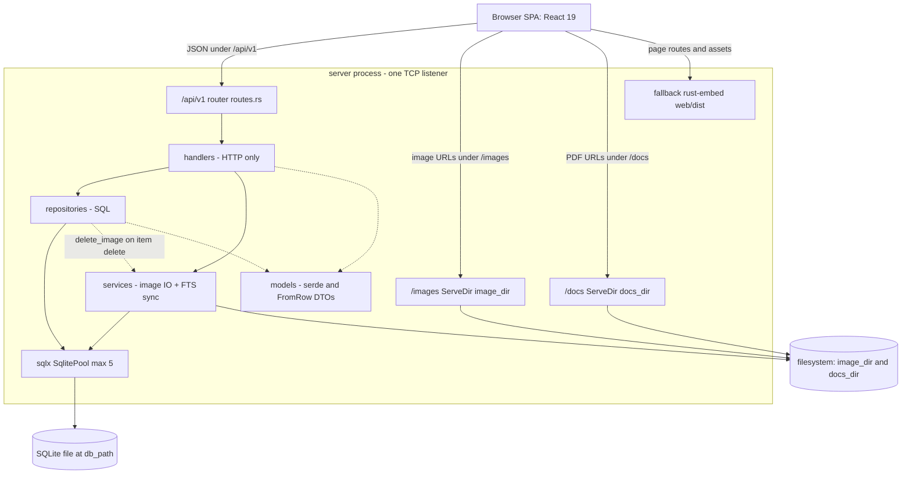
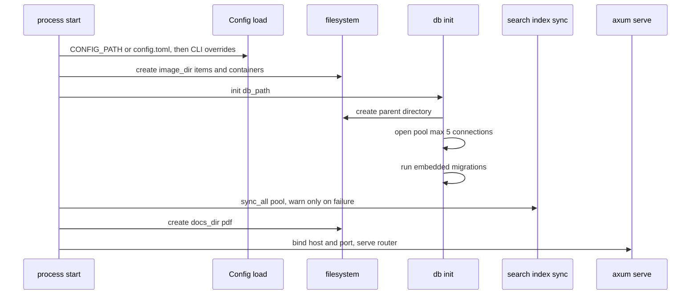

# System shape and runtime domains

wheremystuff is a personal "where did I put this thing" inventory tool. At runtime it is a single Rust binary: the workspace root `Cargo.toml` declares one member, `server`, which holds the Axum HTTP server, the sqlx/SQLite data access, the file-storage logic, and the compiled React SPA embedded with `rust-embed`. There is no separate worker process, no message queue, no external database, and no frontend web server in production — one process on one TCP address owns the API, the uploaded media, the documents, and the UI shell.

That single-process shape is the most important fact for anyone changing the code: a change that looks like it lives in "the frontend" may require rebuilding the binary, a change that looks like it lives in "the API" may have to touch filesystem paths in `config`, and a change that looks like it lives in "the database" is an automatically-applied migration file.

Related reading: [HTTP API surface, DTO semantics, and error contract](http-api-and-errors.md) for the route table and error envelope, [data model and migrations](data-model-and-migrations.md) for tables and delete side effects, [frontend/backend contract](../integrations/frontend-backend-contract.md) for how the SPA consumes these routes, and [build and run](../operations/build-and-run.md) for build, install, container, and service wiring.

## Four runtime domains, one router

`server/src/main.rs` builds one `Router` and mounts four distinct request domains on it, in this order:

| Mount | Implementation | What it owns | Backing state |
| --- | --- | --- | --- |
| `/api/v1` (nested router) | `routes::api_routes(pool)` from `server/src/routes.rs` | Every JSON endpoint: categories, containers, items, images/documents upload, tags, search, stats | `SqlitePool` via the router state |
| `/images` (`nest_service`) | `tower_http::services::ServeDir::new(image_dir)` | Original uploaded images and 300 px thumbnails, addressed by the DB-stored relative path | `config.data.image_dir` directory tree |
| `/docs` (`nest_service`) | `ServeDir::new(docs_dir)` | Uploaded PDFs, addressed by the DB-stored relative path | `config.data.docs_dir` directory tree |
| fallback | `static_files::handler` in `server/src/static_files.rs` | The SPA bundle baked into the binary from `web/dist`, plus `index.html` response for any unmatched path | Compile-time embedded assets |

Three global layers wrap all four: `DefaultBodyLimit::max(100 * 1024 * 1024)` (a 100 MB ceiling for PDF uploads, applied to every request), `CorsLayer::permissive()`, and `TraceLayer::new_for_http()`. The per-file limits are *not* these layers — they come from `config.upload.max_file_size` / `max_doc_size` and are enforced inside handlers and `services::image`.

Two consequences of this mounting order are easy to miss:

- **The SPA fallback is the catch-all for everything, including unknown API paths.** A request under `/api/v1` that matches no registered path falls through to `static_files::handler` and gets `index.html` with `200 OK`, not a JSON 404. Only a registered path with the wrong method produces `405`.
- **The static-file handler is not a 404-machine.** `WebAssets::get(path)` is tried first, then `index.html` is returned for anything else, always with status `200` and a hand-rolled MIME table (`mime_guess`). A stale asset filename therefore returns HTML with a 200 status, which looks like a broken page rather than a missing file.



One Axum router serves the JSON API, two filesystem prefixes, and the embedded SPA, all sharing the same SQLite pool.

## Boot sequence and startup side effects

`main` is a `#[tokio::main]` function that returns `()`, so every startup step is fail-fast via `expect`: a bad config file, an unbindable port, an unmigratable database, or a missing `web/dist/index.html` aborts the process instead of surfacing a typed error. The only non-fatal startup step is the search-index rebuild.

1. `tracing_subscriber` is initialised with `RUST_LOG`-style `EnvFilter`, defaulting to `info,tower_http=debug`.
2. `config::Config::load()` resolves configuration (see [below](#configuration-and-what-it-does-not-control)).
3. `image_dir/items` and `image_dir/containers` are created, so the two image subdirectories exist before any upload arrives.
4. `db::init(&config.data.db_path)` creates the DB file's parent directory, opens a pool (`max_connections(5)`, `create_if_missing(true)`) and runs the migrations embedded by `sqlx::migrate!("./migrations")`.
5. `services::search_index::sync_all(&pool)` wipes and rebuilds the whole `items_fts` index; failure is logged as a warning and ignored.
6. `docs_dir/pdf` is created.
7. The router is composed and the listener is bound at `{host}:{port}` and served with `axum::serve` — there is no `with_graceful_shutdown`, so in-flight requests are dropped on termination.



Startup ordering: directories, then the migrated pool, then a full FTS rebuild, then the listener. Only the FTS rebuild may fail without aborting.

Because migrations and the FTS rebuild run on every boot, restarting the binary is a legitimate repair action for schema and search-index drift — but it is also the only automatic one; see [data model and migrations](data-model-and-migrations.md) for what each migration does.

## The layering a change must respect

The intended boundary, stated in `AGENTS.md`, is:

```
routes.rs → handlers/ (HTTP only) → services/ (images, FTS sync) → repositories/ (SQL) → models/ (DTOs)
```

That is the right mental model for *where new code belongs*, and it is what the code mostly does:

- `routes.rs` contains no logic — it is a flat table of `route(path, method(handler))` calls and one `.with_state(pool)`.
- Handlers are thin: they take `State<SqlitePool>`, `Path`, `Query`, `Json`, or `Multipart`, translate into a repository call, and return `AppResult<Json<…>>`.
- Repositories hold all SQL. Aggregation across tables lives there too (for example `container::detail` in the handler assembles `container::get` + `container::get_path` + `container::list` + `item::list`, but each query belongs to a repository).
- `models/` is pure data: `serde` `Serialize`/`Deserialize` plus sqlx `FromRow` derives. There is no domain behaviour, validation, or invariant enforcement in the model types.

The real dependency pattern is thinner and messier than the arrow diagram suggests, and a change must respect the actual shape rather than the ideal one:

- **Handlers call repositories directly for nearly all CRUD.** Category, tag, and stats handlers *only* touch repositories. There is no service object mediating item or container mutations.
- **`services/` contains exactly two modules.** `image` (validate, write, thumbnail, delete) and `search_index` (`sync_item`, `sync_all`). Every other concern — pagination clamps, tag replacement, path computation, existence checks — lives in repositories or handlers. There is no transaction wrapper, no unit-of-work, and no policy layer to extend.
- **Coordination that would normally be a service lives in the handler.** `POST /items`, `PUT /items/{id}` and `POST /items/{id}/images` each perform two or three steps in sequence (write, then `services::search_index::sync_item`, or save image, then `item::add_image`), so a failure between steps leaves partial state. `DELETE /items/{id}` even issues its own `DELETE FROM items_fts …` raw SQL from the handler rather than going through `search_index`.
- **There is a real layer inversion.** `repositories::item::delete` calls `services::image::delete_image` to unlink files after the row is gone, so a repository depends on the service layer. Extending item deletion with new file-backed children means following that downward-for-upward call pattern or fixing it deliberately.

Practical consequence: adding an endpoint is a two- or three-file change (`routes.rs` route, `handlers/<domain>.rs` function, plus a repository function and possibly a `models` DTO), while adding behaviour that spans tables or files has no established seam — the handler is the de facto orchestrator.

## Application state, configuration, and filesystem ownership

The Axum state is **only the `SqlitePool`**. Everything else is process-global:

- **Configuration is re-read per request, not shared.** The images/documents handlers call `crate::config::Config::load()` inside the request path, which re-reads `config.toml` from disk (or re-applies defaults, or exits the process on a CLI parse error) each time. `main` loads config once for its own boot decisions, but that value is not passed into the router state. So editing `config.toml` while the server runs affects file *paths* used by upload/delete handlers but not the already-registered `ServeDir` mounts, the DB path, or the bound address.
- **`Config::load()` precedence** is: file at `$CONFIG_PATH` (default `config.toml`, relative to the working directory) if it exists, otherwise `Config::default()`, then `--host` / `--port` / `--help` CLI overrides. Unknown CLI arguments print an error and `exit(1)`.
- **Default data location** is `$XDG_DATA_HOME/wheremystuff` if set, else `$HOME/.local/share/wheremystuff`, else the relative directory `data` — with `wheremystuff.db`, `images`, and `docs` inside it. This is why the process must be started from a stable working directory when `config.toml` or the `data` fallback is relied on: the config path is relative and the fallback path is relative.
- **Upload limits are strings parsed at use time.** `upload.max_file_size` defaults to `"10MB"` and `upload.max_doc_size` (optional, `#[serde(default)]`) to `"50MB"`; `parse_size` accepts `KB`/`MB`/`GB` and silently treats a unit-less or unknown unit as MB, and an unparseable number as `10`.
- **The filesystem is the second store and it is addressed by relative paths.** The DB records paths relative to `image_dir` (`items/{uuid}.{ext}`, `{uuid}_thumb.{ext}`, `containers/{uuid}.{ext}`) and relative to `docs_dir/pdf` (`{uuid}.pdf`); `main` serves exactly those trees at `/images` and `/docs`. Nothing is written outside `image_dir`, `docs_dir`, or `db_path`, and the SQLite file itself is never exposed. The SPA composes URLs as `/images/{thumb_path}` and `/docs/pdf/{file_path}`, which means the on-disk layout, the mount prefixes, and the frontend string concatenation are one contract with three owners — see [frontend/backend contract](../integrations/frontend-backend-contract.md).

One dev-mode caveat follows from that contract: `web/vite.config.ts` proxies only `/api` and the legacy prefix `/data/images` to the backend, while the SPA requests `/images/…` and `/docs/pdf/…`. Image and document URLs therefore resolve only when the page is served by the Rust binary (built `web/dist` or the fallback mount), not through the Vite dev server.

## Module inventory at a high level

The crate is small and flat; the module tree in `main.rs` is the full inventory:

| Module | Responsibility |
| --- | --- |
| `config` | TOML + env + CLI configuration, data-directory resolution, size parsing |
| `db` | Pool construction and migrated startup; no repository logic |
| `error` | `AppError` (`NotFound`/`BadRequest`/`Internal`), `AppResult`, `IntoResponse` mapping to `{ "error": … }` |
| `routes` | The single route table and pool state wiring |
| `handlers` | One module per API domain: `category`, `container`, `item`, `search`, `stats`, `tag` |
| `repositories` | One module per SQL domain: `category`, `container`, `item`, `search`, `tag`; search also backs `/stats` |
| `services` | `image`, `search_index` — the thin service layer |
| `models` | DTOs per domain plus `search` types, re-exported from `models/mod.rs` |
| `static_files` | `rust-embed` asset handler and MIME mapping |

`handlers`, `repositories`, and `models` are deliberately parallel: adding a domain means adding a file to each, while `routes.rs` is the only place the domain becomes reachable.

## Failure semantics and invariants worth knowing

- **Errors are typed at the boundary, not before it.** All handler failures funnel through `AppError`; `sqlx::Error::RowNotFound` converts to `NotFound`, other SQL errors and any `std::io::Error` (including image/file writes) become `Internal`, which is logged with `tracing::error!` and returned to the client as the fixed string `"internal server error"` — internal details never leak. Because `From<io::Error>` is blanket-implemented, a filesystem failure after a successful DB write yields a 4xx/5xx response for an operation that partially succeeded.
- **There is no authentication or authorization layer anywhere.** No extractor, middleware, or session checks credentials; CORS is permissive; `/images` and `/docs` are plain static mounts. The security boundary is entirely the network (default bind `127.0.0.1:3000`, or a reverse proxy in `deploy/nginx/`). Any change that exposes new process or data paths must maintain that assumption or add auth deliberately.
- **The SQLite pool is capped at 5 connections** and every handler shares it through state, so slow queries and file IO serialise against that ceiling; there is no read replica or caching layer.
- **The FTS index is derived state that code, not the database, keeps in sync.** Item create/update re-sync, item delete removes the row, and every boot rebuilds everything — but tag/container/category renames do not resync affected items, so search silently lags until restart. Touching those writes means adding explicit `sync_item` calls; see the search section of [data model and migrations](data-model-and-migrations.md).
- **No automated tests protect any of this.** `server/tests/` is empty, no module contains `#[cfg(test)]` code, and the `reqwest`/`tempfile` dev-dependencies are unused; `cargo test -p server` runs zero tests. The only enforced gate is the frontend `tsc -b` (via `pnpm build` / `just lint`) plus `cargo clippy`.

## Extension points

| Change | Where it lands | Watch out for |
| --- | --- | --- |
| New JSON endpoint | `routes.rs` route → `handlers/<domain>.rs` fn → `repositories/<domain>.rs` fn (add a DTO in `models/`) | Unmatched API paths fall through to the SPA fallback, so a typo'd route looks like HTML, not a 404 |
| New persisted field | New `server/migrations/*.sql` file, `models` struct, repository SQL, then `web/src/types/index.ts` by hand | Migrations run automatically on boot; there is no rollback path |
| New stored file kind | New subdirectory created in `main.rs`, path written by a handler or `services::image`, served either by an existing mount or a new `nest_service` | Keep stored paths relative; the mounts assume `image_dir`/`docs_dir` roots |
| New tamperable search text | Add the field to `services::search_index::sync_item` and call it from every write that changes it | No triggers exist, so forgetting a call site means stale search until restart |
| New frontend route | `web/src/routes/` (file-based routing regenerates `routeTree.gen.ts`) | The SPA must be rebuilt and the binary recompiled, because `web/dist` is embedded at compile time |

## Where to go next

- Route-by-route contract, pagination clamps, upload constraints, error envelope: [HTTP API surface, DTO semantics, and error contract](http-api-and-errors.md)
- Tables, FTS5 trigram index, delete side effects, migration mechanics: [data model and migrations](data-model-and-migrations.md)
- DTO mirroring, API client, dev proxy, and URL composition rules: [frontend/backend contract](../integrations/frontend-backend-contract.md)
- `just` recipes, single-binary build, install, Podman, systemd, nginx: [build and run](../operations/build-and-run.md)
