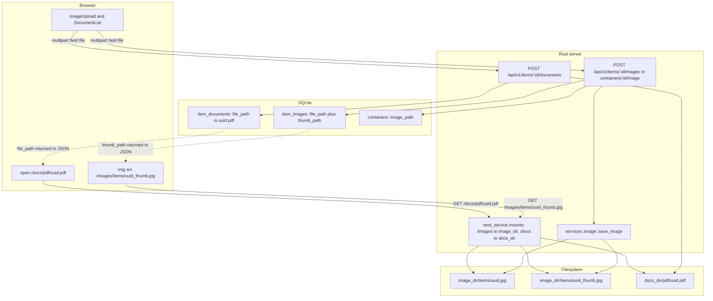

# Uploads, on-disk layout, and served URL contract

wheremystuff keeps two kinds of binary attachments: one or more images per item, one image per container, and any number of PDF documents per item. None of them are stored in SQLite. The rule that ties the whole design together is small and easy to break:

> **The database stores a path relative to a storage root; the server mounts that root at a fixed URL prefix; the client concatenates prefix + stored path.** No component ever writes an absolute path, and the server never emits a URL.

That sentence has three owners — the upload code that chooses the stored string, `server/src/main.rs` that mounts the directories, and the SPA that builds `src`/`href` values — and the three owners do not use the same convention for images and for PDFs. This page documents each side, the upload and delete pipelines around them, and the places where the contract currently leaks (orphan files, a stale dev proxy prefix, and docs that describe an older layout).

## The contract at a glance

Images and PDFs use *different* stored-path shapes, and the difference is the single most common source of confusion:

| What | Column | Stored value (example) | Mounted root | Browser URL |
| --- | --- | --- | --- | --- |
| Item image, original | `item_images.file_path` | `items/{uuid}.jpg` | `/images` = `image_dir` | `/images/items/{uuid}.jpg` |
| Item image, thumbnail | `item_images.thumb_path` | `items/{uuid}_thumb.jpg` | `/images` = `image_dir` | `/images/items/{uuid}_thumb.jpg` |
| Container image | `containers.image_path` | `containers/{uuid}.png` | `/images` = `image_dir` | `/images/containers/{uuid}.png` |
| Item PDF | `item_documents.file_path` | `{uuid}.pdf` | `/docs` = `docs_dir` | `/docs/pdf/{uuid}.pdf` |

- **Image paths already contain their subdirectory.** The stored string starts at `image_dir` (`items/…`, `containers/…`), so the client only prepends `/images/` — see `ImageUpload`, `routes/items/$id/index.tsx`, `routes/items/index.tsx`, `routes/search.tsx`, and `routes/containers/$id.tsx`.
- **Document paths do not.** `upload_document` in `server/src/handlers/item.rs` writes the file to `docs_dir/pdf/` but stores only `{uuid}.pdf`, so `DocumentList` prepends `/docs/pdf/` to reach the file. The `pdf` segment exists in the URL but not in the DB value.
- **The API returns only these relative strings**, never URLs: `ItemImage.file_path`/`thumb_path`, `ItemSummary.thumb_path`, `ItemDocument.file_path`, `Container.image_path`. Any consumer outside `web/src` must hard-code the same two prefixes.

Thumbnail selection is also part of the contract: `item_images.sort_order` is assigned as `MAX(sort_order) + 1` on insert, and item lists / search results read the lowest-`sort_order` row's `thumb_path` as the item thumbnail (`ItemSummary.thumb_path`, `Option<String>` and `NULL` when the item has no image). So the *first uploaded* image is what a list page shows, and that image's thumbnail column — not the original — must exist on disk for the list to look right.

## On-disk layout

Both roots come from configuration (`config.data.image_dir`, `config.data.docs_dir`), defaulting to `~/.local/share/wheremystuff/images` and `~/.local/share/wheremystuff/docs`. Startup creates the subdirectories up front (`main.rs` creates `image_dir/items`, `image_dir/containers`, and `docs_dir/pdf`), so an upload never has to guess whether its directory exists — although `save_image` and `upload_document` both call `create_dir_all` again anyway.

```
{image_dir}/                     mounted at /images
├── items/
│   ├── {uuid}.{ext}             original, exactly as uploaded
│   └── {uuid}_thumb.{ext}       300px thumbnail, format derived from {ext}
└── containers/
    └── {uuid}.{ext}             original only; a {uuid}_thumb.{ext} is written but never recorded

{docs_dir}/                      mounted at /docs
└── pdf/
    └── {uuid}.pdf               DB value is "{uuid}.pdf", i.e. relative to pdf/
```

Two layout invariants are worth protecting when changing this code:

- **The stored filename is always a fresh UUID plus a normalized extension; the client filename is never used.** Only its extension is inspected, so an upload cannot influence the path it lands in. The original display name survives only for PDFs, in the `item_documents.filename` column.
- **The extension in the stored path is the extension in the URL.** There is no content negotiation and no rewriting, so a renamed or removed extension breaks existing links.

## Upload pipeline

Image uploads go through one shared function; PDF uploads are implemented inline in the item handler and share no code with it.

### Images: `services::image::save_image`

`save_image(data, filename, image_dir, subdir, max_size)` in `server/src/services/image.rs` is the only writer of image files, called from `handlers::item::upload_image` with `subdir = "items"` and from `handlers::container::upload_image` with `subdir = "containers"`. Its steps, in order, matter because each failure leaves a different residue:

1. **Size check on the buffered bytes.** `data.len() > max_size` → `400 file too large: {n} bytes (max {m})`. The check happens *after* `field.bytes()` has already buffered the whole part in memory in the handler, so the limit controls what is accepted, not how much memory a request may consume.
2. **Extension allow-list.** The lowercase extension must be one of `jpg`, `jpeg`, `png`, `webp`, `avif` → otherwise `400 unsupported file type: {ext}`. This is the only format gate; there is no MIME sniffing.
3. **Write the original first.** A new `uuid::Uuid::new_v4()` names the file, the directory is created if needed, and the bytes are written unchanged as `{image_dir}/{subdir}/{uuid}.{ext}`.
4. **AVIF short-circuit.** If the extension is `avif`, `save_image` returns immediately with `thumb_path` equal to `file_path`, because decoding AVIF is not available without a system `libdav1d`. An AVIF item image therefore has no separate thumbnail on disk; every thumbnail slot serves the full original.
5. **Decode.** `image::load_from_memory` validates the payload and yields `400 invalid image: {…}` for garbage. Note the ordering: the "original" file from step 3 is already on disk at this point, so a rejected non-image leaves an orphan file behind (see the gaps below).
6. **Thumbnail.** `img.thumbnail(300, 300)` fits the image into a 300×300 box preserving aspect ratio. The output format follows the *normalized* thumbnail extension — `jpeg` becomes `jpg`, everything else is kept — and the encoder is chosen from that extension (`ImageFormat::Jpeg` / `Png` / `WebP`, default JPEG). The file is `{uuid}_thumb.{thumb_ext}` in the same subdirectory, so a JPEG upload lands as `{uuid}.jpeg` plus `{uuid}_thumb.jpg`.

`save_image` returns `SavedImage { file_path, thumb_path }`, both relative to `image_dir` including the `subdir` segment. The bytes of both files are written with blocking `std::fs` calls from inside an async handler; there is no spawn_blocking and no streaming.

### Images: what the handlers do with the result

Both image endpoints read the first multipart field named `file` (extra fields are ignored, and a request with no `file` field fails with `400 no file field found in multipart`), default the filename to `image.jpg` when the client omits one, and re-read `config.toml` inside the request path (`Config::load()`) to obtain `image_dir` and `max_file_size_bytes()`.

- `POST /api/v1/items/{id}/images` verifies the item exists first (missing item → `404`), calls `save_image`, then inserts the row via `item::add_image` and returns the created `ItemImage`.
- `POST /api/v1/containers/{id}/image` does the same up to `save_image` and then calls `container::set_image(pool, id, &saved.file_path)` — **only `file_path` is persisted**. The thumbnail is generated and written but no column records it, so a container image always renders at original size and the `_thumb` file is unreachable. This endpoint has no SPA caller: `web/src/lib/api.ts` exposes item image/document uploads but nothing for `/containers/{id}/image`, and `routes/containers/$id.tsx` only renders `container.image_path` when it is already set.

### PDFs: inline in `handlers::item::upload_document`

Documents bypass `services/` entirely. `upload_document` reads the `file` field, defaults the name to `document.pdf`, rejects any extension other than `pdf` with `400 只支持 PDF 文件`, buffers the bytes, and checks `config.max_doc_size_bytes()` → `400 文件过大: …`. It then writes `{docs_dir}/pdf/{uuid}.pdf` and calls `item::add_document(pool, id, &rel_path, &filename, "pdf")`, which stores the bare `{uuid}.pdf` path plus the client's original filename.

Consequences: **no PDF is ever rewritten, renamed, previewed, or thumbnailed**, `doc_type` is always the literal `"pdf"`, and — unlike image validation — a `.pdf`-named non-PDF is accepted, because nothing inspects the payload.

## Upload → disk → row → browser URL



One image and one PDF: the DB string plus a fixed client-side prefix is the whole mapping from request to URL, and both URL prefixes are served by `ServeDir` mounts in the same binary.

## Where the URL contract is enforced

There are exactly three enforcement points, and changing the layout requires touching all of them:

1. **Storage roots and mounts** — `server/src/main.rs` builds `.nest_service("/images", ServeDir::new(image_dir))` and `.nest_service("/docs", ServeDir::new(docs_dir))`. Nothing else in the router matches those prefixes; the third mount is the embedded SPA fallback.
2. **Stored strings** — `services::image::save_image` (images, `subdir/filename`) and `handlers::item::upload_document` (PDFs, filename only). These are the only two writers, which is why the asymmetry is easy to fix in one place later.
3. **Client-side concatenation** — `/images/${…}` appears in `ImageUpload`, the item list, item detail, container detail, and search; `/docs/pdf/${doc.file_path}` appears only in `DocumentList`.

Because the SPA fallback is a catch-all that returns `index.html` with `200 OK` for any unmatched path, a broken media URL usually fails in a confusing way: an `` receives HTML instead of a 404. `ServeDir` itself returns a real `404` for a missing file under a mounted prefix, so an orphaned row degrades to a broken image while a wrong *prefix* degrades to an HTML payload.

## Deletion and lifecycle gaps

Deleting attachments is handled in three different places with three different levels of completeness:

| Operation | DB rows | Files |
| --- | --- | --- |
| `DELETE /api/v1/items/{id}/images/{image_id}` | row deleted (`item::remove_image`) | original **and** thumbnail unlinked |
| `DELETE /api/v1/items/{id}/documents/{doc_id}` | row deleted (`item::remove_document`) | PDF unlinked |
| `DELETE /api/v1/items/{id}` | item row; `item_images`/`item_documents`/`item_tags` go with the FK cascade | image originals **and** thumbnails unlinked; **PDFs are not** |
| `DELETE /api/v1/containers/{id}` | container row; items and children detached | **no files touched** |

The concrete gaps in today's code:

- **Item deletion leaks PDFs.** `item::delete(pool, id, image_dir)` only takes `image_dir`; it collects `item_images` rows, deletes the item, then calls `services::image::delete_image` per image. `item_documents.file_path` values are never read, so every PDF of a deleted item stays in `docs_dir/pdf/` forever. Extending the cleanup means threading `docs_dir` (and the document paths) through the same delete path — the repository already reaches "downward" into `services::image`, so the pattern exists but is not applied to documents.
- **Container images are never deleted.** `container::delete` performs only SQL, and there is no route to clear or replace `image_path`: re-uploading a container image simply overwrites the column, orphaning the previous file (and each upload already leaves an unreferenced `_thumb`).
- **Failed validation leaves files.** Since `save_image` writes the original before decoding it, a file with an allowed extension but non-image contents returns `400` after the file is already on disk.
- **A failed DB insert leaves files too.** Both image handlers write files first and insert second; an `add_image`/`set_image` error returns `500` with the file already written. There is no compensating unlink anywhere.
- **AVIF double-unlink is harmless but odd.** For AVIF, `file_path == thumb_path`, so `delete_image` calls `remove_file` twice on the same path and ignores both results (`let _ =`).

Nothing reconciles the filesystem against the database — no startup scan, no CLI, no repair command. In practice, clearing orphans means comparing `image_dir`/`docs_dir` contents against the `item_images`, `containers.image_path`, and `item_documents` columns by hand.

## Development mode: the media proxy does not match the contract

`web/vite.config.ts` proxies exactly two prefixes to `http://127.0.0.1:3000`:

```ts
"/api": { target: "http://127.0.0.1:3000", changeOrigin: true },
// Uploaded images are served by the Rust binary (paths stored in the DB).
"/data/images": { target: "http://127.0.0.1:3000", changeOrigin: true },
```

Neither the SPA's `/images/…` prefix nor its `/docs/pdf/…` prefix is in that list. Under `just dev` / `pnpm dev` (Vite on `127.0.0.1:5173`) the browser therefore asks the Vite server for media, not the Rust binary:

- `/images/items/…` and `/docs/pdf/…` are not proxied, so they are not served from `image_dir`/`docs_dir` at all during dev.
- The `/data/images` proxy entry is itself dead config: the backend mounts `/images`, so a proxied request for `/data/images/...` matches no route and falls through to the embedded SPA handler, which answers `200` with `index.html`.

**Verify before assuming media works under `pnpm dev`.** The reliable ways to see images and PDFs are to run the built binary (`just build && just run`, which serves `web/dist` and the mounts from the same origin) or to add a proxy entry for `/images` and `/docs` pointing at `127.0.0.1:3000` while developing. The same mismatch applies to the deployment docs: `deploy/nginx/wheremystuff.conf` forwards `location /` to the backend (which is correct for both prefixes) but its optional static-image block is commented out as `location /data/images/ { alias …/data/images/; }` — if that block is ever enabled verbatim against the current code, it serves nothing, because the binary exposes `/images`, not `/data/images`.

## Limits and configuration that affect uploads

| Setting | Where | Default | Behaviour |
| --- | --- | --- | --- |
| `data.image_dir` | `config.toml`, else `$XDG_DATA_HOME/wheremystuff/images` | — | Root of `/images`; read at startup for the mount and per upload request for writes |
| `data.docs_dir` | `config.toml`, else `<data dir>/docs` | — | Root of `/docs`; `pdf/` subdirectory created at startup |
| `upload.max_file_size` | `config.toml` | `"10MB"` | Image limit checked inside `save_image` on buffered bytes |
| `upload.max_doc_size` | `config.toml` | `"50MB"` | PDF limit checked in `upload_document` |
| `DefaultBodyLimit::max(100 * 1024 * 1024)` | `main.rs` layer | 100 MB | Hard ceiling for every request; a larger body is rejected by the layer (413) and never reaches the JSON error envelope |

Because `image_dir` and `docs_dir` are re-read per upload/delete request but the `ServeDir` mounts are fixed at boot, changing `config.toml` while the server runs makes writes and unmounts disagree: new files land in the new directory while `/images` still serves the old one. Restart the binary after changing either path. See [configuration](../operations/configuration.md) for the full precedence rules (file, then defaults, then `--host`/`--port`).

## Documentation drift to keep in mind

The storage story is documented in four other places, and three of them describe the pre-`/images` layout:

- `AGENTS.md` ("Images") still says images are served at `/data/images`, that the API returns filesystem-relative `data/images/...` paths, that the SPA renders `/{path}`, that Vite proxies `/data/images`, and that allowed formats are `jpg/jpeg/png/webp`. Current code: mount prefix `/images`, subdir-relative stored paths, SPA prefixes `/images/`, a Vite proxy that no longer matches anything, and `avif` in the allow-list.
- `README.md` / `README.en.md` repeat the `/data/images` proxy and the optional `location /data/images/` nginx block, and their runtime-data tree lists only `wheremystuff.db` and `images/` — `docs/` is missing.
- `docs/design.md` describes the flow as returning `{ id, url, thumb_url }` and supporting only `jpg, png, webp`. The API returns stored paths (`file_path`/`thumb_path`), not URLs, and AVIF is accepted.
- `deploy/nginx/wheremystuff.conf` carries the stale `/data/images/` comment described above.

Treat `server/src/main.rs`, `services/image.rs`, `handlers/item.rs`, and the `web/src` string concatenations as authoritative when these disagree.

## Verification status

There are no automated tests for any of this: `server/tests/` contains no tests, no module carries `#[cfg(test)]`, and `cargo test -p server` runs zero tests — so `save_image`'s ordering, the extension normalization, and the delete paths are unprotected by CI. Verification today is manual: upload one JPEG (expect `{uuid}.jpeg` + `{uuid}_thumb.jpg` and a working `/images/items/{uuid}_thumb.jpg`), one AVIF (expect `thumb_path == file_path` and no `_thumb` file), a `.png` containing text (expect `400 invalid image` *and* an orphan file), and a PDF (expect `/docs/pdf/{uuid}.pdf` to open); then delete the item and confirm the images disappear from `image_dir/items/` while the PDF remains in `docs_dir/pdf/`.

## Related pages

- [HTTP API surface, DTO semantics, and error contract](../architecture/http-api-and-errors.md) — route table, multipart shapes, and the JSON error envelope these handlers return.
- [Frontend/backend contract](../integrations/frontend-backend-contract.md) — how the SPA composes these URLs and mirrors these DTOs.
- [Create and edit an item](../workflows/create-and-edit-item.md) — the UI flow that creates an item and then uploads its images.
- [Configuration](../operations/configuration.md) — precedence of `config.toml`, environment, and CLI overrides.
- [Data model and migrations](../architecture/data-model-and-migrations.md) — the `item_images`, `item_documents`, and `containers` tables behind these paths.
