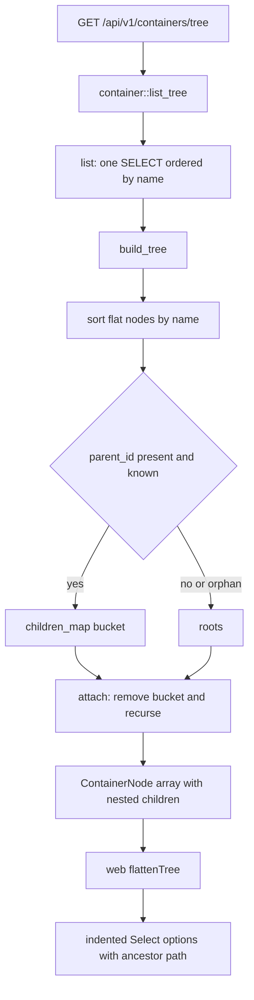
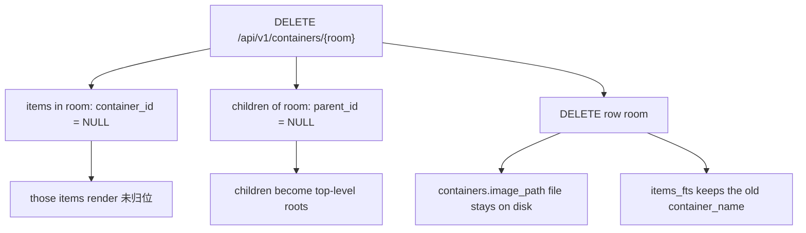

# Hierarchies, container paths, and location modeling

wheremystuff answers one question — *where is my thing* — with **two independent trees**. `categories` says what an item *is*; `containers` says where it *lives*. Both are plain adjacency lists: a single nullable `parent_id` column, no materialized path, no depth, no closure table, no sibling-ordering column. Everything else on this page is a consequence of that one storage decision — the tree shape and the "where" string are recomputed from flat rows on every request.

Related reading: [data model and migrations](../architecture/data-model-and-migrations.md) for the schema, keys, and declared foreign-key actions; [search and index sync](search-and-index-sync.md) for why a rename only shows up in search after a restart; [browsing and managing containers](../workflows/browse-and-manage-containers.md) for the page-level walkthrough; [file storage and URL contract](file-storage-and-url-contract.md) for the container image that a delete leaves behind.

## Two trees, two jobs

| Tree | Table | Item link | Meaning in the UI | Rendered as |
| --- | --- | --- | --- | --- |
| Categories | `categories` | `items.category_id` | Classifies the item ("what") | Bare name only — no ancestor path |
| Containers | `containers` | `items.container_id` | Physical placement ("where") | Full root→leaf path everywhere |

The asymmetry is deliberate enough to notice: `ItemDetail.category_name` is a single `Option<String>` resolved with one scalar query, while `ItemDetail.container_path` is a whole `Vec<PathSegment>`. A category has a hierarchy you can navigate on `/categories`, but an item never displays where its category sits in the tree; a container's full ancestry is on screen in three different places.

Containers carry *two* pieces of location description: the tree position (`parent_id` chain) and a free-text `items.location_note` ("床底下的蓝色箱子、第三格") that the user writes when the tree is not granular enough. `location_note` is indexed for search; it is not parsed and never influences the derived path.

Both trees have the same structural properties: unbounded depth, no `UNIQUE` on `name`, no ordering column. Sibling order is therefore alphabetical by `ORDER BY name` — byte-order comparison on UTF-8, so Chinese names sort by code point rather than by pinyin. Users cannot reorder siblings; renaming is the only lever.

## Storage shape and what it costs

`server/migrations/0001_init.sql` defines `containers` with `parent_id TEXT REFERENCES containers(id) ON DELETE SET NULL` and `container_type TEXT NOT NULL DEFAULT 'other'`, plus `idx_containers_parent`; `categories` mirrors it with `parent_id` and `idx_categories_parent`. Both tables are read and written only through `server/src/repositories/{container,category}.rs`; handlers never touch SQL (see [HTTP API and errors](../architecture/http-api-and-errors.md) for the layering rule).

Because there is no denormalised path or depth:

- **Reads pay the assembly cost.** `list_tree` loads the entire table per request; `get_path` issues one `SELECT` per ancestor. Nothing is cached server-side.
- **Writes are trivially cheap and non-cascading.** Reparenting is one `UPDATE`, which is also why an invalid reparent has no schema-level guard to stop it (see the cycle section below).
- **A dangling `parent_id` is representable.** `INSERT`/`UPDATE` never validate that the parent exists; with FK enforcement off (any connection that is not sqlx's default), a container can point at a row that no longer exists. `build_tree` tolerates this by promoting the node to a root.

## Assembling the trees: `build_tree`

`container::list_tree` and `category::list_tree` are two lines: fetch every row with `list(pool, None)` / `list(pool)`, hand the flat vector to a private `build_tree`, return the roots. `build_tree` exists in both repositories with near-identical bodies — the category copy still declares a `remaining` vector that is never pushed into before `roots.append(&mut remaining)`, a leftover from an earlier design; the container copy dropped it. Any change to tree semantics must be made twice.

The algorithm, in order:

1. Wrap every row in a node (`ContainerNode { container, children: vec![] }` or the category equivalent).
2. Sort the flat vector by `name`. This sort is the *only* ordering step; it is applied once, up front.
3. Collect the set of all ids present in the table.
4. Partition: a node whose `parent_id` is `Some(pid)` **and** `pid` is in the id set goes into `children_map[pid]`; everything else becomes a root. The `ids.contains(pid)` guard is what makes an orphan (`parent_id` pointing at a missing row) or a `NULL` parent a top-level node instead of an invisible one.
5. Recursively `attach` children: `map.remove(&node.id)` yields the child bucket, each child is attached depth-first, then pushed. `remove` guarantees a node is consumed at most once, so the recursion terminates even if the data contains a cycle — and children stay name-sorted because the bucket was filled from the sorted vector.



*build_tree turns one flat, name-sorted SELECT into nested nodes; the SPA then flattens the same tree for its pickers.*

Serialization detail that makes the wire shape work: `ContainerNode` uses `#[serde(flatten)]` on its `container` field, so JSON nodes are a container's fields plus a `children` array — which is exactly the `ContainerNode extends Container` type in `web/src/types/index.ts`.

### Why the tree is built in Rust, not SQL

SQLite supports `WITH RECURSIVE` on a self-referencing table, and a single recursive CTE could in principle emit a depth-annotated flat list. The code does not use one, for reasons that are visible in the data flow:

- **The wire format is nested, not flat.** Producing nested arrays in SQL would require `json_group_array`/`json_object` plus string handling; assembling `Vec<ContainerNode>` in Rust yields the exact DTO with no serialization round-trip.
- **One query instead of one per level.** A naive recursion (`list(parent_id)` in a loop) would be N+1 by depth; `build_tree` makes a single unbounded `SELECT` and does the join in memory.
- **Policy lives in one function.** Orphan promotion, name ordering, and cycle safety are three small rules that are easier to read in Rust than in a recursive CTE, and they must match the category implementation.
- **The ceiling is a personal inventory.** The cost is `O(containers)` per tree request with no caching. The SPA refetches the whole tree after every container mutation (`useCreateContainer`/`useUpdateContainer` invalidate the `["containers"]` query key), and the item create/edit forms each mount their own `useContainerTree()`. This is fine at hundreds of containers and would need a cache or a lazy-per-level endpoint at tens of thousands.

### Failure modes of the assembly

- **Nodes inside a parent cycle disappear from the tree.** If A's parent is B and B's parent is A, both land in `children_map` and neither is a root, so `attach` never reaches them: they are absent from `/api/v1/containers/tree` (and therefore invisible in the `/containers` page and in every picker) while still existing in the database, still returned by the flat `/api/v1/containers` endpoint, and still reachable by direct URL. A self-parent (`parent_id == id`) fails the same way.
- **Nothing prevents creating such a cycle.** The container edit form only removes the container *itself* from the parent options (`flattenTree(allContainers).filter((c) => c.value !== container.id)`); descendants stay selectable, and `PUT /api/v1/containers/{id}` accepts any `parent_id` string. Neither repository nor schema checks ancestry.
- **Duplicate attachment is impossible**, by construction of `remove`, so a malformed row cannot duplicate a subtree.

## Deriving "where": `get_path`

`container::get_path(pool, id)` is the single implementation of "the location of this thing":

```rust
let mut path = vec![];
let mut current_id = Some(id.to_string());
while let Some(cid) = current_id {
    let c = get(pool, &cid).await?;          // one SELECT per ancestor
    path.push(PathSegment { id: c.id.clone(), name: c.name });
    current_id = c.parent_id;
}
path.reverse();                               // root -> leaf
```

Four properties matter:

- **Iterative, not recursive.** The walk is a `while` loop over `parent_id` links, so tree depth costs no stack.
- **Leaf-first collection, then reversed.** The segment array is always root→leaf, which is what breadcrumbs and paths assume; the container itself is the last element.
- **One query per ancestor, uncached.** There is no path memoisation and no join: a depth-5 container is 5 round-trips to the pool. Callers amplify this — `item::list` and `search::search` resolve a path *per returned row*, so a 100-item page at depth 3 is up to 300 extra queries. `handlers::container::detail` calls `get_path` after `container::get`, so the container row itself is fetched twice.
- **No cycle guard.** There is no visited set, so a cycle (or a self-parent) makes the loop run forever, appending a segment per iteration. That request never returns and grows memory until the process dies. Because every item list row, item detail, and search hit calls `get_path`, a single bad `parent_id` row takes down listing and search, not just the offending container's page. If you add cycle detection, add it here *and* reject cyclic writes in `container::update`.

A missing ancestor also aborts the whole request: `get` returns `AppError::not_found` ("container {id} not found"), so a dangling `parent_id` surfaces as a `404` on an unrelated item page rather than as a truncated path (see [HTTP API and errors](../architecture/http-api-and-errors.md) for the error mapping).

### One type, three render sites

`PathSegment { id, name }` is declared once in `server/src/models/container.rs` and reused verbatim, so the JSON shape is identical everywhere:

| Endpoint | Field | Frontend consumer | Presentation |
| --- | --- | --- | --- |
| `GET /api/v1/containers/{id}` | `ContainerDetail.path` | `routes/containers/$id.tsx` | Linked breadcrumb, `/` separators, last segment as plain bold text |
| `GET /api/v1/items/{id}` | `ItemDetail.container_path` | `routes/items/$id/index.tsx` | The "位置" info row: each segment is a `Link` to its container, `ChevronRight` separators, `未归位` when empty |
| `GET /api/v1/items`, `GET /api/v1/search` | `ItemSummary.container_path` | `routes/items/index.tsx`, `routes/search.tsx` | One-line text via `containerPathText`, prefixed with 📍 |

`ContainerDetail` also carries `children: Vec<Container>` (one level, via `list(pool, Some(id))`) and `items: Vec<ItemSummary>` for the items *directly* in that container. Two consequences for the location model:

- **Location filtering is exact, never subtree.** `item::list` filters with `i.container_id = ?`; asking for "工作室" does not return items that are in the drawer on the desk in that room. The container detail page likewise shows no descendant items, so finding something three levels down means clicking three times.
- **The item list on a container page is capped.** `handlers::container::detail` calls `item::list` with `page: Some(1), size: Some(100)` and drops `total`, so a container holding more than 100 items silently renders only the first 100, newest first.

## Rendering the trees in the SPA

### `flattenTree`: nested nodes → indented options

`web/src/lib/utils.ts` provides the client-side inverse of `build_tree`:

```ts
flattenTree(nodes, depth = 0, parents = []): FlatTreeNode[]
```

It is a depth-first `flatMap` that emits `{ value: id, label: name, depth, path }` for each node followed by its descendants, where `path` is the accumulated ancestor names joined with `" › "` (the comment in the source uses `"工作室 › 大桌子"` as the example). Because it inherits the server's ordering, the resulting option list is alphabetically depth-first — parents always before their children, so the indentation reads as a file tree.

The companion `Select` component consumes both extra fields:

- **`depth` becomes indentation.** Each option's label is padded by `depth * 16` px, so nesting is visible inside the dropdown.
- **`path` becomes the trigger text.** The closed button renders `selected.path ?? selected.label`, so picking "第三格" shows "工作室 › 大桌子 › 抽屉" — the user always sees the full location of their choice, not an ambiguous leaf name.
- **The filter matches the path.** `Select`'s searchable mode tests `path + label`, so typing an ancestor's name surfaces all of its descendants.

Call sites, and the subtle differences between them:

| File | Purpose | Notable |
| --- | --- | --- |
| `web/src/routes/categories.tsx` | Parent picker for creating a category, and for editing one | Edit filters out `c.value !== node.id` (self only) |
| `web/src/routes/containers/$id.tsx` | "上级容器" picker in the edit form | Also filters self only; placeholder "无（顶层）" |
| `web/src/routes/items/new.tsx`, `web/src/routes/items/$id/edit.tsx` | "存放位置" picker | Placeholder "未归位", sends `container_id || undefined` |

The top-level container create form on `/containers` deliberately has **no parent picker** — it posts `{ name, label, container_type }` and therefore always creates a root. Child containers are created from the detail page's `CreateChildForm`, which posts an explicit `parent_id`. So the only way to build depth is to navigate to the intended parent first.

### `containerPathText`: the one-line fallback

```ts
export function containerPathText(path) {
  if (!path || path.length === 0) return "未归位";
  return path.map((p) => p.name).join(" › ");
}
```

This is the terse renderer used in dense lists — item cards and search hits — and it is where the product's `未归位` ("not put away") vocabulary comes from: an item with `container_id = NULL` gets an empty `container_path`, which becomes a neutral, non-error label rather than "(unknown)". The two rich render sites bypass it: the container detail breadcrumb links each segment with `/` separators, and the item detail "位置" row links each segment with `ChevronRight` icons and prints plain `未归位` when the array is empty. Neither links the `未归位` placeholder to anything — there is no "unfiled items" route.

## Deleting a node: nullify, don't cascade

`container::delete` is three statements in a fixed order, and the order is what the outcome depends on:

1. `UPDATE items SET container_id = NULL WHERE container_id = ?`
2. `UPDATE containers SET parent_id = NULL WHERE parent_id = ?`
3. `DELETE FROM containers WHERE id = ?`

`category::delete` is the exact parallel with `category_id`. Neither path recurses, so nothing else in either tree is removed. The declared `ON DELETE SET NULL` clauses would do the same thing, but the explicit statements make the behaviour independent of pragma state (see [data model and migrations](../architecture/data-model-and-migrations.md) for why that belt-and-braces approach matters for the item delete path in particular).



*Deleting a middle node promotes its children to roots and unfiles its own items; it does not delete, reparent, or reindex anything else.*

Consequences a reader must internalise before "cleaning up" a tree:

- **Deleting a middle node flattens the level below it.** A 抽屉 inside a 箱子 becomes a root container, not a child of the 箱子. The alternative (reparenting to the grandparent) is not implemented.
- **Only items directly in the deleted container become 未归位.** Items in surviving descendants keep their `container_id` and therefore keep their full path until their own container is touched.
- **The container image is orphaned.** Unlike `item::delete`, which unlinks each `file_path`/`thumb_path`, `container::delete` never touches the file at `containers.image_path` — the row disappears and the file stays under `image_dir/containers/`. See [file storage and URL contract](file-storage-and-url-contract.md).
- **Search keeps the deleted name.** `items_fts.container_name`/`category_name` are only rewritten by `sync_item` on item create/update and by `sync_all` at startup, so a delete (like a rename) leaves stale text in the index until restart. See [search and index sync](search-and-index-sync.md).
- **The UI navigates to the parent after deleting a container** (`navigate` to `container.parent_id` if present, else `/containers`), which still exists because children are only unparented one level up.

## The `container_type` vocabulary

`container_type` is a free-form `TEXT NOT NULL DEFAULT 'other'` column with **no `CHECK` constraint and no server-side validation**. Whatever string a client posts is stored; `container::create` merely substitutes `"other"` when the field is omitted.

The product vocabulary lives entirely in the SPA, duplicated inline in three components:

| Value | Label | Where offered |
| --- | --- | --- |
| `room` | 房间 | Create form on `/containers` (initial value), edit form, child form |
| `table` | 桌子 | all three |
| `shelf` | 架子 | all three |
| `box` | 箱子 | all three (initial value of the child form) |
| `drawer` | 抽屉 | all three |
| `cabinet` | 柜子 | all three |
| `bag` | 袋子 | all three |
| `other` | 其他 | all three |

Two inconsistencies follow from that duplication. **Defaults differ by entry point**: the `/containers` create form starts at `"room"`, while `CreateChildForm` starts at `"box"`; both always send a value, so the DB default of `'other'` is only reachable through the API. **Display is raw**: the tree page prints `{node.container_type}` and the detail page prints `类型: {container.container_type}`, so users see the lowercase identifier, not the Chinese label — unlike `sourceTypeLabel` in `web/src/lib/utils.ts`, there is no `containerTypeLabel`, and no type icon per value. `docs/design.md` lists a narrower vocabulary (`room / shelf / box / drawer / bag / other`, no `table`/`cabinet`), so treat the frontend option arrays as the source of truth.

## What the update path cannot do

`container::update` is a read-modify-write merge, and the merge direction is load-bearing:

```rust
.bind(input.name.as_deref().unwrap_or(&existing.name))
.bind(input.label.as_deref().or(existing.label.as_deref()))
.bind(input.parent_id.as_deref().or(existing.parent_id.as_deref()))
```

Omitted or `null` fields keep the stored value; only a present string overwrites. So:

- **A container can be moved but never promoted to a root.** `"parent_id": null` deserializes to `None`, and `.or(existing.parent_id)` restores the old parent. The edit form's "无（顶层）" placeholder cannot express "no parent" either — the selected `""` becomes `parent_id: parentId || undefined`, which `JSON.stringify` drops from the body. The same applies to the "顶层" placeholder when editing a category.
- **Label and description cannot be cleared from the edit form.** Empty inputs are sent as `label || undefined` / `description || undefined`, which the merge treats as "leave unchanged". (Sending `""` directly through the API would store an empty string; the UI never does.)
- **Reparenting is unchecked.** Any accepted id is written as-is, which is how the undisplayable cycles described above can be created through normal UI use.

If you need "un-parent" support, the change is in both layers: distinguish absent from explicit `null` in `UpdateContainer` (e.g. `Option<Option<String>>` or a dedicated move endpoint), and stop coalescing `""` to `undefined` in `EditContainerForm`.

## Entry points, operations, and verification

The HTTP surface (routed in `server/src/routes.rs`, all under `/api/v1`) is minimal: `GET /containers` (optional `?parent_id=` exact filter), `GET /containers/tree`, `GET /containers/{id}` (detail: container + `path` + direct children + up to 100 items), `POST /containers`, `PUT /containers/{id}`, `DELETE /containers/{id}`, `POST /containers/{id}/image`; `GET /categories`, `GET /categories/tree`, `POST /categories`, `PUT /categories/{id}`, `DELETE /categories/{id}`.

There are **no automated tests** in this repository — `server/tests/` is empty and `cargo test -p server` compiles nothing, so tree behaviour is verified by hand. When changing `build_tree`, `get_path`, or the flatten/render pipeline, the smallest checks that cover the invariants on this page are:

1. Create three levels (room → box → drawer), confirm `/containers/tree` nests them and each picker shows the indented, ancestor-labelled option.
2. Reparent the drawer directly under the room via the edit form; confirm the breadcrumb and `containerPathText` both shorten while the drawer's items keep their `container_id`.
3. Delete the middle box; confirm the drawer becomes a root, the box's own items show `未归位`, and the drawer's items keep their path.
4. Point one container's `parent_id` at a nonexistent id in SQLite and reload: the node should appear as a root (not vanish), and any item in it should still resolve a path — the failure case to watch is a `parent_id` cycle, which makes `/containers/tree` hide both nodes and makes `get_path` hang for any request that renders an item in them.
