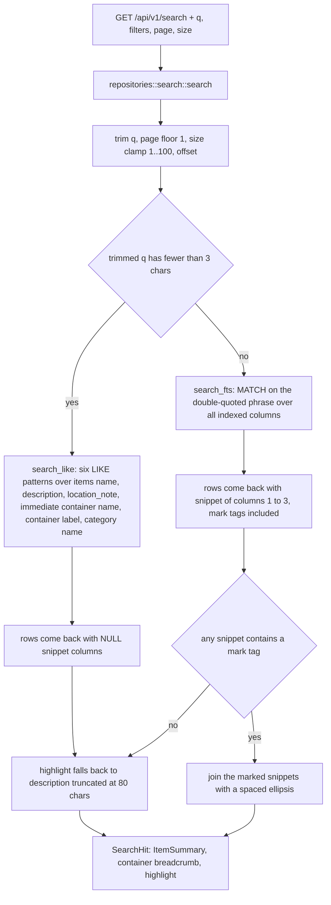
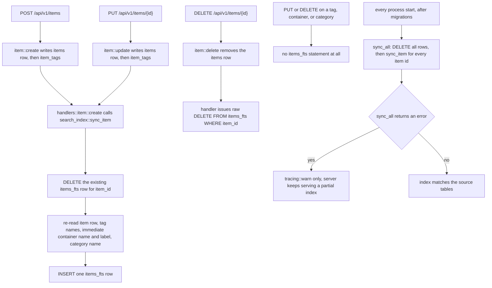

# Full-text search and FTS index synchronization

Search is the one subsystem in this application that answers from a **copy** of the data. `items_fts` is an FTS5 virtual table holding denormalised text — item name/description/location note, its tag names, its immediate container's name and label, and its category name — and every hit is joined back to `items` for the real columns. Everything interesting about search follows from that split: the index can be stale, the index only knows some of the text, and queries shorter than three characters are not answered by the index at all.

Related reading: [data model and migrations](../architecture/data-model-and-migrations.md) for the schema and migration mechanics behind `items_fts`, [HTTP API and errors](../architecture/http-api-and-errors.md) for the request layer and pagination echo, [hierarchy and location](hierarchy-and-location.md) for the container tree that produces the breadcrumb on every hit, and [search and retrieval](../workflows/search-and-retrieval.md) for the user-facing walkthrough.

## The contract

`GET /api/v1/search` accepts `q` (required), plus optional `category_id`, `container_id`, `source_type`, `page`, `size` (`SearchQuery` in `server/src/models/search.rs`). It returns `{ items, total, page, size }` where each hit is `{ item: ItemSummary, highlight: string | null }`.

The handler (`server/src/handlers/search.rs`) is a single delegation to `repositories::search::search`; no business logic lives above the repository. The repository guarantees:

- **Hits are always real items.** Both SQL paths join `items`, so a leftover `items_fts` row for a deleted item can never surface as a result or inflate `total`.
- **Matching covers items, tags, and the item's *immediate* container/category.** Ancestor containers are not searched: `sync_item` and the LIKE query both join only `i.container_id`/`i.category_id`, so an item in 箱子 inside 房间 is not findable by "房间" even though the breadcrumb shows it. Purchase fields (`purchased_at`, `bought_from`, `price`) are not searchable at all.
- **Ordering differs by path.** The FTS path pages over `ORDER BY rank` (bm25, all seven columns equally weighted, no secondary key); the LIKE path pages over `ORDER BY i.created_at DESC`. Neither has a tiebreaker.
- **`highlight` is a pre-rendered HTML fragment, not plain text.** Produced by this module, consumed with `dangerouslySetInnerHTML` (see [the UI rendering contract](#the-ui-rendering-contract)).
- **Pagination is clamped and echoed.** `page` defaults to 1 and is floored at 1; `size` defaults to 20 and is clamped to `1..=100`, so a client can only learn its `size=500` was reduced from the echoed `size`.

`total` is computed by a second query in each path, so it is a true count of matches rather than the length of the page.

## Query planning: one branch, at three characters



*Query planning and highlight assembly in `repositories::search.rs`; the three-character test is on characters, not bytes.*

The discriminator is `use_like = q.chars().count() < 3` — a character count, so one CJK ideograph counts as one and two-hanzi queries take the fallback. The reason is the tokenizer: trigram FTS5 needs at least three characters to form a token, so shorter queries would simply match nothing.

### Path A — `MATCH` for three or more characters

The index it queries, as created by `0001` and recreated with `location_note` in `0003`:

```sql
CREATE VIRTUAL TABLE items_fts USING fts5(
    item_id UNINDEXED,      -- soft pointer back to items.id, not searchable
    name,                   -- column 1
    description,            -- column 2
    location_note,          -- column 3 (added by 0003)
    tags,                   -- column 4, space-joined tag names
    container_name,         -- column 5, immediate container only
    container_label,        -- column 6
    category_name,          -- column 7
    tokenize = 'trigram'
);
```

`item_id UNINDEXED` means the join key never contributes matches; the other seven columns are all matched by an unqualified `MATCH`. `tokenize = 'trigram'` is what makes CJK text searchable at all: unicode61 would treat a run of hanzi as one token, while trigram indexes every three-character window, giving substring matching — at the cost of a three-character floor and snippets measured in characters.

The query string is wrapped as `format!("\"{q}\"")`, i.e. always a **quoted phrase**. That has two consequences worth knowing before "improving" search:

- It neutralises FTS5 query syntax. `AND`, `*`, `(`, `-`, `NOT`, or a `name:foo` column filter typed by a user are phrase text, not operators, so they cannot change which rows match.
- It removes operators on purpose. There is no prefix matching, no `OR`, no column-scoped search reachable from the API. Substring matching inside the phrase is what the trigram tokenizer provides; that is the whole query language.
- One hole: the query is concatenated, not escaped, so a `q` containing a double quote produces an unbalanced phrase (`"a"b"`). FTS5 rejects that as a syntax error, which the handler turns into a 500 rather than an empty result. The SPA search box is a plain text input with no character filtering, so a real user typing a quote into it can trigger this.

The count query joins `items` (`SELECT COUNT(*) FROM items_fts f JOIN items i ON i.id = f.item_id WHERE items_fts MATCH ? AND …`), then the list query adds `snippet()` and ordering:

```sql
snippet(items_fts, 1, '<mark>', '</mark>', '…', 20) as name_snippet,
snippet(items_fts, 2, '<mark>', '</mark>', '…', 32) as desc_snippet,
snippet(items_fts, 3, '<mark>', '</mark>', '…', 32) as note_snippet
...
FROM items_fts f JOIN items i ON i.id = f.item_id
LEFT JOIN categories c ON c.id = i.category_id
WHERE items_fts MATCH ? AND <filters>
ORDER BY rank
LIMIT ? OFFSET ?
```

Column **indices** 1/2/3 address `name`, `description`, `location_note` positionally; they are an API of the schema, not a convenience. Because the tokenizer is `trigram`, a "token" is a three-character sequence, so the 20/32 token budgets translate to roughly 20/32 characters of context — the snippets are short by construction.

Filters are appended through one helper (`extra_where`) that always seeds `1=1` and then adds `i.category_id = ?`, `i.container_id = ?`, `i.source_type = ?` in that order; binds follow the same order in both statements. There is no tag filter in search (`tag_id` exists only on `GET /items`), and no filter on the FTS columns themselves.

### Path B — `LIKE` below three characters

The fallback binds `%q%` six times and enumerates the searchable text directly:

```sql
WHERE (i.name LIKE ? OR i.description LIKE ? OR i.location_note LIKE ?
       OR ct.name LIKE ? OR ct.label LIKE ? OR c.name LIKE ?)
  AND <filters>
```

Three properties distinguish it from the FTS path:

1. **It reads live tables, so it cannot drift.** Rename a tag, a container, or a category and a two-character query finds the new name immediately — the same rename leaves the ≥3-character path stale until restart (see [the drift invariant](#the-drift-invariant-the-index-lags-and-nobody-notices-unless-you-do)).
2. **It produces no highlights.** The SELECT projects `NULL as name_snippet, NULL as desc_snippet`, so every hit falls into the description-truncation fallback. Two-character searches therefore look uniformly unhighlighted by design.
3. **Container and category text is matched but not shown as a match.** `ct.name`, `ct.label`, and `c.name` are folded into the same `LIKE` disjunction as the item's own text, so a query matching only a container label returns the item with no visible reason — the label appears nowhere on the hit, and the only container text on screen is the `container_path` breadcrumb of ancestor names.

Two behaviours at the low end of this path are easy to trip over:

- **`q` is only trimmed, never rejected.** An empty query is a valid request: `LIKE '%%'` is true for every `i.name` (NOT NULL), so `GET /search?q=` returns the whole inventory newest-first. The SPA never sends it (`useSearch` is `enabled: params.q.trim().length > 0`), but the API is exposed.
- **A mapping asymmetry.** `SearchRow` declares three snippet fields; the LIKE SELECT aliases only `name_snippet` and `desc_snippet`, with no `note_snippet` column. sqlx's derived `FromRow` resolves fields by column name, and nothing here is annotated `#[sqlx(default)]` — so this query shape depends on the row type tolerating a missing column. Treat the short-query path as **the least verified code in the subsystem** (there are no tests; see [validation](../testing/validation-playbook.md)) and add the missing `NULL as note_snippet` when you next touch it.

The practical consequence of the branch itself: **the same term can return different totals and different ordering** at two versus three characters, because the two paths match different text with different rank functions. This is not a bug to "fix" by unifying them — it is the reason the fallback exists.

## Highlight assembly

Assembly is a small, deterministic pass over the three snippet columns, and the rules explain almost every "why does this result look unhighlighted" report:

| Situation | Resulting `highlight` |
| --- | --- |
| Any of `name`, `description`, `location_note` snippets contains `<mark>` | The marked fragments, in name → description → location-note order, joined with `" … "` |
| No marked fragment (match came from `tags`, `container_name`, `container_label`, or `category_name`) | `description` truncated to 80 characters plus `…`, or `null` when the item has no description |
| LIKE path (both snippets are SQL `NULL`) | Same description-truncation fallback |
| Item has no description and nothing marked | `null` — the SPA renders no highlight line at all |

Two details drive the first row. `snippet()` is **per column**, so a row that matched only in a column outside 1–3 still yields *text* from columns 1–3 — just without any `<mark>` marker — and the `contains("<mark>")` test is what discards it. Second, the fallback truncates by `chars()`, appending a real `…`, so multi-byte text is not split mid-character.

The breadcrumb is not part of the FTS row: after the rows come back, each hit with a `container_id` triggers `container::get_path`, which walks up the tree one `get` per ancestor level — so a page of `size` hits costs one query per hit times its container depth (see [hierarchy and location](hierarchy-and-location.md)).

## The UI rendering contract

`web/src/routes/search.tsx` renders the fragment raw:

```tsx
{hit.highlight && (
  <p className="text-sm text-gray-500 mt-1 line-clamp-2"
     dangerouslySetInnerHTML={{ __html: hit.highlight }} />
)}
```

- **`<mark>` is real inline markup to the browser, and the rest of the string is not escaped.** Whatever the user typed into `name`/`description`/`location_note` is interpolated into that HTML. This is tolerable only because the corpus is one household's own inventory; anyone exposing the app beyond that must escape at assembly time (in `repositories::search.rs`, not in the component) or the highlight becomes a stored-XSS sink.
- **`highlight` is nullable in both DTOs** (`Option<String>` in Rust, `string | null` in `web/src/types/index.ts`), so the component must keep the `&&` guard.
- **`q` and `page` live in the URL**, not in component state: `validateSearch` coerces `q`/`page` with `|| ""` and `|| 1`, the form navigates to `/search` with the trimmed query and `page: 1`, and paging is two `<Link>`s. `useSearch` is a TanStack Query keyed on the whole params object.
- **Result count and paging come from the server's echo**: `data.total` drives `找到 N 个结果`, and pagination compares `data.total > data.size` — so a clamped `size` changes the page count the user sees.
- **Cache invalidation mirrors the server's sync list.** `useItems` invalidates `["search"]` on item create/update/delete; `useTags`, `useContainers`, and `useCategories` never do. So a tag or container rename does not even re-fetch the current result list, let alone reindex it.

## Which writes keep the index fresh

There are **no triggers** in this schema (the trigger design in `docs/design.md` was never implemented), and `items_fts` is not an external-content table. Its only writers are in `server/src/services/search_index.rs` and one raw statement in `handlers::item::delete`.



*Every path that touches `items_fts` — and the one that deliberately does not.*

| Event | Mechanism | Failure behaviour |
| --- | --- | --- |
| Item create | `handlers::item::create` → `sync_item(pool, detail.item.id)` **after** `item::create` has written tags | `?` propagates, so the request is a 500 even though the item row already exists unindexed; only a restart repairs it |
| Item update | `handlers::item::update` → `sync_item(pool, id)` after tags are replaced | same as above |
| Item delete | `item::delete`, then `DELETE FROM items_fts WHERE item_id = ?` **in the handler** | raw statement failure surfaces as 500 with the item already gone |
| Server start | `main.rs` runs `sync_all(&pool)` between `db::init` and the router | warn-only: a wiped or half-rebuilt index is treated as degraded, not fatal |
| Tag rename / delete | nothing | stale |
| Container rename / label change / delete | nothing | stale |
| Category rename / delete | nothing | stale |
| Item image or document upload/delete | nothing needed (`items_fts` holds no media text) | — |

`sync_item` is a **delete-then-insert of one row**, not an upsert, and it is not transactional: an error between the two statements leaves that item unindexed (not double-indexed). It re-derives every indexed field from the source tables on each call, which is why calling it is always safe and why it is the correct repair primitive. It also returns `Ok(())` when the item no longer exists (the re-read finds no row), so the delete handler's raw SQL is a convention rather than a necessity: calling `sync_item` after `item::delete` would have produced the same result.

`sync_all` is `DELETE FROM items_fts` followed by a `sync_item` loop over every item id — roughly six statements per item, all outside one transaction. It is therefore both the **only** bulk repair path and the **only** path that rewrites tag/container/category text.

## The drift invariant: the index lags, and nobody notices unless you do

> **`items_fts` is only refreshed for item writes and at process start. A rename or delete of a tag, container, or category leaves every affected item's index row describing the old world, and nothing in the running process ever notices.**

Concretely, after such a write, until the next restart:

- **Stale hits.** The old tag name, container name/label, or category name remains searchable and still returns the item. A user who renamed 充电器 to 充电头 can still find the item by 充电器 and possibly *not* by 充电头, depending on the other indexed columns.
- **Missed hits.** The new text is invisible to the ≥3-character path. Short queries are unaffected, because the LIKE path reads the live tables.
- **Inconsistent evidence within one hit.** Because the list SELECT joins `categories` live, `item.category_name` shows the *new* name while a marked `category_name`-driven match would be impossible — the displayed breadcrumb and the matched text can disagree.
- **Deletes are worse than renames.** `tag::delete` cascades `item_tags` away and `container::delete`/`category::delete` null the item's foreign key, so the source of the text is gone while the index still holds it. Search can return an item for a string that no longer exists anywhere in the database.
- **Search is not the only lagging consumer.** The SPA does not invalidate its `["search"]` queries on those mutations either, so the user may keep seeing a cached result list that agrees with neither the index nor the tables.

The invariant also fixes the boundary of a safe change: **any new write path that alters indexed text must resync the affected items itself.** For a rename, gather the linked item ids first (`SELECT item_id FROM item_tags WHERE tag_id = ?`, or `SELECT id FROM items WHERE container_id = ?`) and call `search_index::sync_item` per id inside the same handler, accepting the same non-transactional partial-failure semantics as item create/update. For a bulk tree edit, `sync_all` is the blunt alternative. Adding SQL triggers instead is a real option, but it would make the index contract implicit — the reason the code spells it out is `docs/design.md`'s warning that triggers make tokenisation and index content harder to control.

Operationally, drift is invisible: nothing is logged, no endpoint reports index health, and `GET /stats` counts rows in the source tables only. The only observation is a mismatched count or a stale hit.

## Changing what search covers

A field becomes searchable in five coupled places; missing any one produces a silently wrong index rather than an error:

1. **Schema** — a new migration (FTS5 tables cannot be altered) that drops and recreates `items_fts` with the new column; `0003_item_location_note.sql` is the worked example, and the rebuild is safe only because `sync_all` repopulates on the same startup.
2. **`sync_item`** — add the column to the `INSERT INTO items_fts (...)` list and to the gathering queries above it (or the INSERT and the column count diverge).
3. **`repositories/search.rs`** — add a `snippet(items_fts, N, …)` in the position the new column occupies in the FTS table; renumbering existing columns silently moves highlights to the wrong field.
4. **The LIKE fallback** — add the column to *both* the count and list `WHERE` clauses and to the six-fold bind loop, whose literal `0..6` is easy to forget.
5. **`sync_all`** — no change needed (it loops `sync_item`), which is the point of keeping the per-item path authoritative.

Nothing sits behind a feature flag or config key; the tokenizer, snippet sizes, `<mark>` markers, ellipsis, page defaults, and the three-character threshold are all hard-coded constants in `server/src/repositories/search.rs`, `server/src/services/search_index.rs`, and the migrations.

## Failure modes and how to check this area

There are no automated tests for search: `server/tests/` is empty and `AGENTS.md` records the same, so `cargo test -p server` proves nothing here. The checks that do work:

```bash
# index size vs. source-of-truth size, on a stopped or idle server
sqlite3 "$XDG_DATA_HOME/wheremystuff/wheremystuff.db" "SELECT (SELECT COUNT(*) FROM items), (SELECT COUNT(*) FROM items_fts);"

# does a specific item's indexed text match the tables? (drift forensics)
sqlite3 "$XDG_DATA_HOME/wheremystuff/wheremystuff.db" "SELECT tags, container_name, category_name FROM items_fts WHERE item_id = '<uuid>';"

# three-character boundary: same term, two different code paths
curl -s 'http://127.0.0.1:3000/api/v1/search?q=ab'  | jq '.total, .items[0].highlight'
curl -s 'http://127.0.0.1:3000/api/v1/search?q=abc' | jq '.total, .items[0].highlight'
```

The second query is the only way to see drift: compare the `tags`/`container_name`/`category_name` strings against `tags`, `containers`, and `categories`, or simply restart and re-run the search that surprised you.

| Symptom | Cause |
| --- | --- |
| Renamed tag/container/category still matches; the new name does not | no resync on those writes — restart, or add `sync_item` calls to the handler |
| Search returns nothing right after a deploy or migration | `sync_all` failed (warn-only) or the migration ran outside the Rust startup path, leaving `items_fts` empty |
| Highlights point at the wrong field | `items_fts` column order changed without updating the `snippet()` indices |
| Short queries fail outright while longer ones work | the LIKE branch selects only two of the three snippet columns `SearchRow` asks for — the least verified path in the subsystem; fix by adding `NULL as note_snippet` |
| A result shows no highlight at all | the match came from `tags`/`container_*`/`category_name`, or the item has no description |
| Same-term result order and totals change at exactly three characters | the two paths rank over different text — expected |
| A quote character in the query returns 500 | the phrase wrapper `"q"` does not escape embedded `"`, so FTS5 reports an unterminated string and the sqlx error maps to `AppError::Internal` |
| Item findable by its own name but not by the room it sits in | only the immediate container is indexed, never ancestors |
| Leaked HTML in a highlight line | user-entered text reached `dangerouslySetInnerHTML` unescaped |
