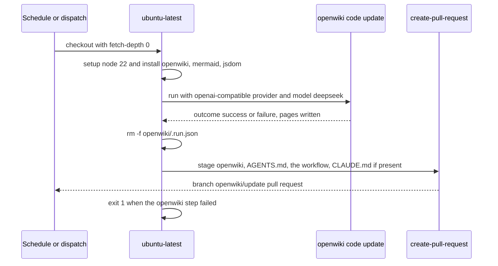

# Sources of truth, generated files, and documentation drift

This repository describes itself in four hand-written prose places — [`AGENTS.md`](../../AGENTS.md), [`README.md`](../../README.md), [`README.en.md`](../../README.en.md), [`docs/design.md`](../../docs/design.md) — plus comments inside the deploy files and a generated `openwiki/` wiki. They do not agree, and they do not disagree uniformly: the documents that are most useful on non-obvious behaviour are the ones with the most stale mechanics, and the document that is best on setup commands is silent on half the feature set. `AGENTS.md` itself warns that `docs/design.md` "is partly aspirational — trust the code for what is implemented", and the product spec repeats that warning for essentially every doc in the list.

The practical rule this page encodes:

> **Code wins. `justfile`/`deploy` win over prose about how to build and ship. `README` wins over `AGENTS.md` on setup and commands. `AGENTS.md` wins on runtime behaviour, but only until you check it. `docs/design.md` states intent and must never be used to infer current state.**

## Precedence order

| Rank | Artifact | What it is authoritative for | Where it fails |
| --- | --- | --- | --- |
| 1 | `server/src/**`, `web/src/**`, `server/migrations/**` | Everything true at runtime: routes, DTOs, storage layout, index sync, defaults | Silent about intent and about anything not yet written |
| 2 | `justfile`, `deploy/**`, `web/vite.config.ts`, `web/package.json` | How the app is actually built, installed, containerised, proxied, typechecked | Comments embedded in them can be stale (see [Deploy comments](#deploy-comments)) |
| 3 | `README.md` / `README.en.md` | Install, deps, `just` recipes, deployment paths — the most accurate prose in the repo | Media URL prefixes, runtime data directory, missing PDF/document feature |
| 4 | `AGENTS.md` | The non-obvious invariants: layer boundary, migration auto-run, trigram FTS, `LIKE` fallback, missing rename resync, `@/*` alias | Image section, config defaults, `components/ui` claim, "no CI/lint" claim |
| 5 | `docs/design.md` | Product intent: page map, ER sketch, desired API shapes | A file tree of files that never existed, trigger-based FTS, two-value `source_type`, shadcn/ui |

Two asymmetries are worth internalising:

- **`AGENTS.md` is right about the subtle things and wrong about the mechanical things.** Its Search section (trigram tokenizer, fewer than three characters falling back to `LIKE`, renames of tags/containers/categories not resyncing items) still matches `server/src/services/search_index.rs` and `server/src/repositories/search.rs` exactly. Its Images and Web notes sections describe a layout the code has left behind.
- **`README` is the reverse.** Its recipes (`just deps`, `dev`, `build`, `install`, `container-*`, `fmt`, `lint`, `check`, `clean`, `reset-db`) match the `justfile`, and its XDG data-directory tree matches `server/src/config.rs`; yet the same file also says the server creates `data/` in the working directory, which contradicts the XDG section further down.

Because `AGENTS.md` is the file an agent reads first, its drift is the most expensive kind: every stale sentence in it is a plausible-looking instruction to build the wrong thing.

## Generated files: never hand-edit

| Path | Produced by | Tracked in git | How to regenerate |
| --- | --- | --- | --- |
| `web/src/routeTree.gen.ts` | `@tanstack/router-plugin` via `TanStackRouterVite(...)` in `web/vite.config.ts`; rewritten on any `pnpm dev`/`pnpm build` that sees a change under `web/src/routes/` | Yes — committed so route imports typecheck without a Vite run | Add or rename a file under `web/src/routes/` and run `pnpm dev` or `pnpm build` |
| `web/tsconfig.tsbuildinfo` | `tsc -b` (i.e. `pnpm build` and `just lint`) | No — `*.tsbuildinfo` is gitignored | Delete it or re-run `pnpm exec tsc -b` |
| `Cargo.lock` | `cargo build` / `cargo update` | Yes | Change a dependency in `server/Cargo.toml` and build; `cargo update -p <crate>` to bump |
| `web/pnpm-lock.yaml` | `pnpm install` | Yes | `just deps` or `cd web && pnpm install`; the container build runs `pnpm install --frozen-lockfile`, so a hand-edited or unsynced lockfile breaks `just container-build` |
| `web/dist/`, `target/`, `node_modules/` | Builds | No | `just build` / `cargo build` |
| `openwiki/**` pages | The OpenWiki GitHub workflow (see below) | Yes | Re-run the workflow or `openwiki code --update`; better, fix the source doc |
| `openwiki/.run.json` | A single OpenWiki run | No — deleted by the workflow before the PR is created | Never commit it |

`web/src/routeTree.gen.ts` is the one that matters most day to day. Its own header says it is automatically generated by TanStack Router and that changes "will be overwritten", and `web/.prettierignore` excludes it (alongside `dist`, `node_modules`, and `pnpm-lock.yaml`) so formatters leave it alone. Editing it by hand to add a route appears to work until the next dev-server boot silently reverts it; the real change is a new file under `web/src/routes/`.

Two consequences of generation that the prose docs under-report:

- **`web/dist` is embedded at compile time, not served from disk at runtime.** `server/src/static_files.rs` derives `RustEmbed` over `#[folder = "../web/dist/"]` and returns `index.html` as the SPA fallback for any unmatched path. That is why a stale binary keeps serving an old frontend after a frontend edit, and why `just build` touches `server/src/main.rs` to force a recompile when `web/src` changed.
- **Editing generated wiki pages is never the fix.** `AGENTS.md` says so explicitly: prefer updating source code or docs and let OpenWiki regenerate.

## Drift observed today

### `AGENTS.md`

| What it says | What the code does | Why it costs time |
| --- | --- | --- |
| Images are served at `/data/images`; the API returns paths like `data/images/...`; the SPA renders them as `/{path}`; Vite proxies `/data/images` | `main.rs` mounts `ServeDir::new(image_dir)` at `/images`; `save_image` stores `{subdir}/{uuid}.{ext}`; the SPA prepends `/images/`; `vite.config.ts` still proxies the obsolete `/data/images` prefix | Following it produces `/data/images/items/…` URLs that hit the SPA fallback and return HTML instead of an image |
| Allowed upload formats are `jpg/jpeg/png/webp` | The allow-list also contains `avif`, which short-circuits thumbnail generation | An agent "fixes" a non-bug or rejects a supported upload |
| `components/ui/` is empty scaffolding; shadcn-style deps are present but unused | `web/src/components/ui/` holds eight working components (`ConfirmDialog`, `DocumentList`, `ImageUpload`, `Lightbox`, `MarkdownText`, `PdfPreview`, `Select`, `Skeleton`); `clsx`, `tailwind-merge`, and `lucide-react` are imported, while `class-variance-authority` and `react-dropzone` are the genuinely unused dependencies | Encourages writing a second `Select` or `ImageUpload` instead of extending the real one |
| There is no lint/format config, no CI, no pre-commit; `tsc -b` is the only frontend gate | `justfile` has `fmt` (rustfmt + prettier), `lint` (clippy + prettier + tsc), and `check`; `rustfmt.toml`, `web/.prettierrc`, `web/.prettierignore` exist; `.github/workflows/openwiki-update.yml` is CI (docs-only) | An agent adds a formatter or linter that already exists, or claims CI cannot run |
| Defaults are `127.0.0.1:3000`, `data/wheremystuff.db`, `data/images` | Defaults resolve `$XDG_DATA_HOME/wheremystuff/` → `~/.local/share/wheremystuff/` → `data/` only when both env vars are unset, and they include `docs_dir` | Points at the wrong database when troubleshooting "empty" data |
| The server must run from the repo root because it serves `web/dist` and `data/` via relative paths | The frontend is compiled in; `config.toml` is still looked up relative to the working directory, and relative data paths apply only in the no-`HOME` fallback | Asserts an unnecessary cwd constraint while the real cwd dependency (`config.toml`) goes unnoticed |
| FTS index fields are item name/description, tag names, container name/label, category name | `location_note` was added to the index by migration `0003` and is populated by `sync_item` | Edits that touch the FTS column list forget a field |

Still accurate in `AGENTS.md`, and worth keeping as the mental model: the `routes.rs → handlers/ → services/ → repositories/ → models/` boundary, embedded migrations that run automatically at startup, UUID ids with TEXT timestamps, the trigram FTS table with its `LIKE` fallback, the fact that only item writes call `sync_item`, the `@/*` → `web/src/*` alias, and "UI text is Chinese".

### `docs/design.md`

- **It lists files that do not and never did exist.** `web/src/App.tsx`, `components/SearchBar.tsx`, `ContainerTree.tsx`, `ContainerPath.tsx`, `ItemCard.tsx`, `ItemForm.tsx`, `ImageGallery.tsx`, `TagInput.tsx`, `CategorySelect.tsx`, and `tailwind.config.ts` are all named in the project tree but absent; the real components live under `components/ui/`, and `routes/items/$id/edit.tsx` exists without being listed. Do not create a file because the design names it.
- **It describes trigger-based FTS sync, then recommends the opposite.** The section is titled "通过 SQLite trigger 保持 `items_fts` 与源表同步" and closes by recommending explicit sync from backend code instead of triggers. The code implements the recommendation: explicit `sync_item`/`sync_all`, and no triggers in any migration.
- **The ER sketch omits the two later migrations.** `items.location_note` and the whole `item_documents` table (plus the `docs_dir` root and the `/docs` mount) are missing from the data model, while `price`, `bought_from`, and `purchased_at` are declared even though the UI never asks for them.
- **`source_type` is documented as two values.** Design says `purchased` or `handmade`; the UI offers five (see [conventions](#product-conventions-the-prose-docs-miss)).
- **The image API shape is wrong.** Design promises `{ id, url, thumb_url }` and formats `jpg, png, webp`; the API returns stored relative `file_path`/`thumb_path` strings and accepts `avif`.
- **The stack table advertises shadcn/ui**; `web/package.json` has no `@radix-ui` or shadcn dependency at all.

Design is still the only place that states *intent* — the page map, container-label semantics, "search under 5 ms at 2000 items" — so read it for goals and never for current state.

### `README.md` / `README.en.md`

- **The media proxy prefix is stale.** Both READMEs say `/api` and `/data/images` are proxied in dev, and the nginx section offers an optional `location /data/images/` static block with `client_max_body_size 20M`. The served prefix is `/images`, so that proxy entry matches nothing and the optional nginx block would serve an empty directory. See [Uploads, on-disk layout, and served URL contract](file-storage-and-url-contract.md) for the full contract.
- **It contradicts itself about the data directory.** The install section says the server creates `data/` in the current working directory, while the configuration section documents `$XDG_DATA_HOME/wheremystuff/`; `README.en.md` repeats both sentences. The XDG section is the one that matches `server/src/config.rs`.
- **The project tree is one level off and incomplete.** It lists `components/` with `Select`, `ImageUpload`, `Skeleton` — those live in `components/ui/` — and it has no `docs/` directory, `item_documents` table, or PDF mention at all.
- **`just test` runs zero tests.** The command table and the "Tests & Linting" heading imply a suite; `just test` is `cargo test -p server`, `server/tests/` does not exist, and no module carries `#[cfg(test)]`.

### Deploy comments

- `deploy/Containerfile` still says the binary "必须从 /app 运行（相对路径读取 web/dist 和 data/）". The frontend is embedded and data defaults to XDG, so the comment explains a constraint that no longer exists — while quietly pointing at a real risk: `just container-run` mounts `./data:/app/data`, and the default data paths do not resolve to `/app/data` unless the container has neither `HOME` nor `XDG_DATA_HOME`. Check where the database actually lands before trusting the volume.
- `deploy/systemd/wheremystuff.service` carries the corrected version of the same note: `WorkingDirectory` affects `config.toml` lookup, data uses the XDG path, and `ReadWritePaths=%h/.local/share/wheremystuff`. When two deploy files disagree, the systemd unit is the one that matches `config.rs`.

## Product conventions the prose docs miss

These are stable product decisions encoded only in the UI code; treat them as conventions to preserve, not incidental strings.

| Convention | Encoding | Notes |
| --- | --- | --- |
| UI copy is Chinese | Every route label, dialog, placeholder, and empty state; server-side user-facing rejections are Chinese too (`只支持 PDF 文件`, `文件过大`) while log and internal messages are English | New UI text should be Chinese; API field names stay English snake_case |
| `source_type` vocabulary is five values | `purchased` 购买, `handmade` 自制, `gift` 赠送, `salvage` 拆卸, `other` 其他 via `sourceTypeLabel` | The DB default is `handmade`; the option lists are duplicated in `routes/items/new.tsx` and `routes/items/$id/edit.tsx`, so adding a value touches three places |
| An item without a container is "未归位" | `containerPathText` returns `未归位` for an empty path; forms use it as the empty-select placeholder | Not a stored value — a render-time fallback, so a search for it proves nothing about the data |
| `description` is Markdown | `MarkdownText` renders item descriptions with `react-markdown` under `prose` typography, with `img` elements disallowed and unwrapped | Users may paste Markdown; embedded images are deliberately stripped |
| Price and date presentation | `formatPrice` → `¥12.00`; `formatDate` → the first 10 characters of the stored TEXT timestamp, `—` when null | Timestamps are `datetime('now')` TEXT values, so slicing is safe but timezone-naive |

## The wiki is generated, not authored

`openwiki/` is refreshed by a scheduled GitHub Action, so it is a fourth documentation artifact with its own lifecycle rather than something a person maintains.

What that means in practice:

- **It runs daily at 08:00 UTC** (`cron: "0 8 * * *"`) and on `workflow_dispatch`, so the wiki can be newer than the prose docs it was generated from.
- **A failed run still opens a PR.** The OpenWiki step is `continue-on-error`, the PR step runs under `!cancelled()`, and a final step re-raises the failure. Only pages completed before the failure are in that PR; merging it makes partial progress the baseline for the next run.
- **`AGENTS.md` is part of the generated blast radius.** It is in the PR's `add-paths` because OpenWiki owns the `<!-- OPENWIKI:START -->` / `<!-- OPENWIKI:END -->` block there. Edits inside that block are regenerated; edits outside it survive.
- **`openwiki/.run.json` is transient run state**, deleted before staging, and must never be committed.
- **Do not hand-edit wiki pages.** When a page is wrong, the durable fix is in a source doc or in the code the page is generated from; a manual patch is overwritten and leaves the underlying prose drift in place.

## Which file owns which fact

Use this when a code change makes a documented statement false.

| Change | Hand-written docs that must follow | Generated / automatic |
| --- | --- | --- |
| New or moved API route | `AGENTS.md` (API), `README` API overview, `web/src/lib/api.ts`, `web/src/types/index.ts` | `routeTree.gen.ts` only for SPA routes |
| New migration, column, or table | `AGENTS.md` (Database & migrations), `docs/design.md` ER sketch, and `AGENTS.md` Search if the column is indexed | `items_fts` rebuild via `sync_all` on next startup |
| New or changed config field | `AGENTS.md` (Config), `README` config block, `docs/design.md` config block, the `deploy/systemd` comment | — |
| Changed upload format, size, or mount path | `AGENTS.md` (Images), `README` dev/nginx notes, `docs/design.md` image flow, the `deploy/nginx` comment, `vite.config.ts` proxy | — |
| New UI component or directory | `AGENTS.md` (Web notes), `README` project structure | — |
| New generated artifact | Add it to `.gitignore` / `web/.prettierignore` and to the table above | — |
| Anything at all | Nothing under `openwiki/` | The scheduled workflow rewrites it |

## Related pages

- [Uploads, on-disk layout, and served URL contract](file-storage-and-url-contract.md) — the `/images` and `/docs` contract that most of the stale prose gets wrong.
- [Build and run](../operations/build-and-run.md) — how `just build`, the embedded frontend, and the release binary fit together.
- [Configuration](../operations/configuration.md) — `config.toml`, `CONFIG_PATH`, `--host`/`--port`, and the XDG data-directory defaults.
- [Quickstart](../quickstart.md) — the shortest correct path from clone to a running instance.
